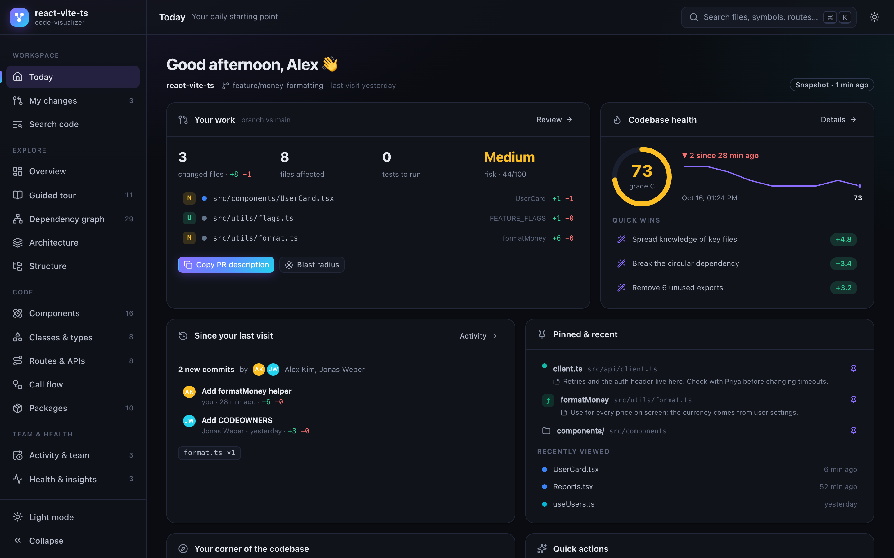
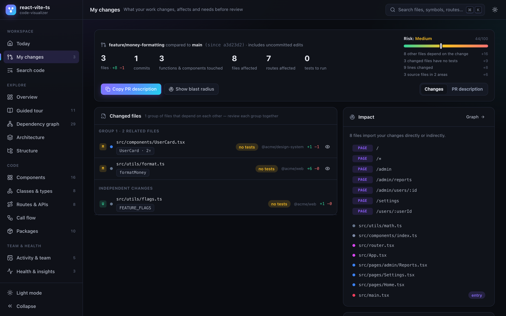
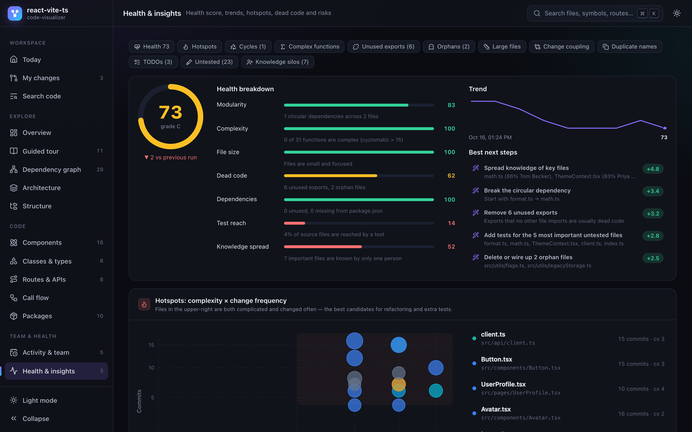
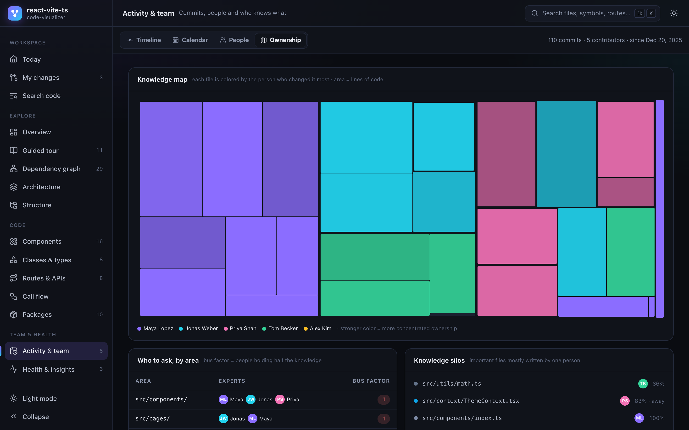
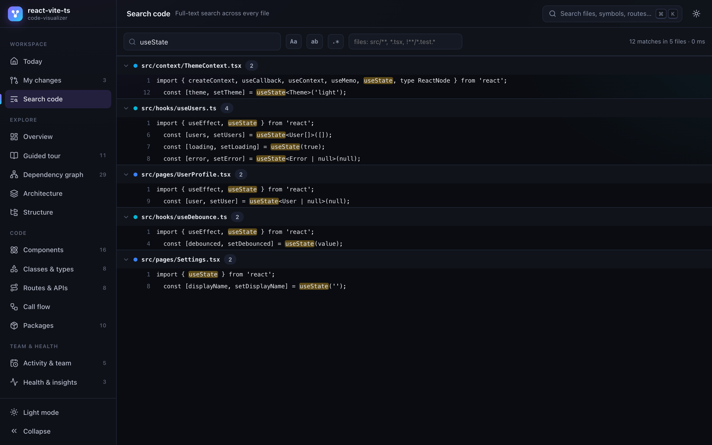
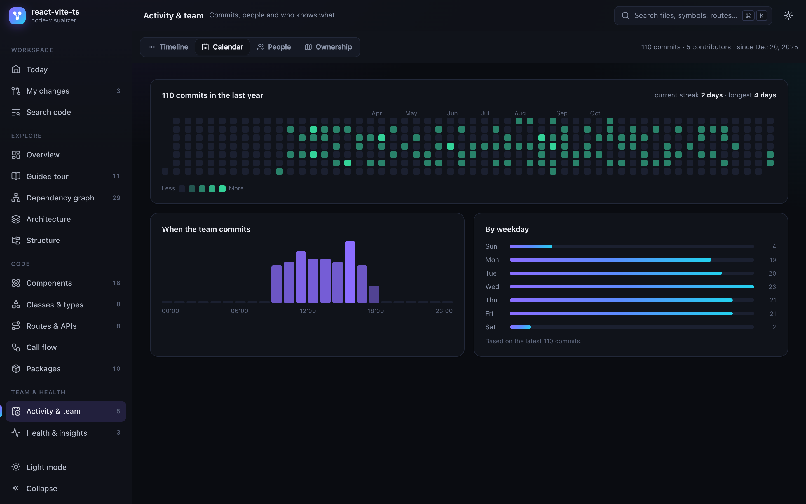
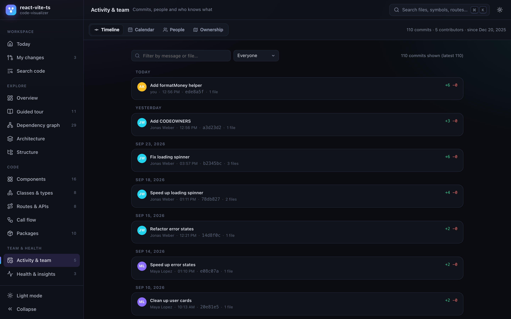
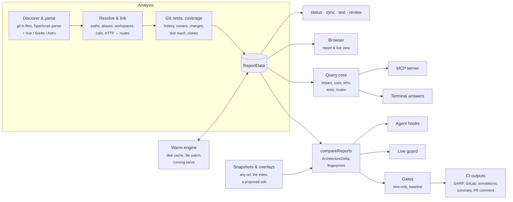

<div align="center">

# ◆ code-visualizer

**Your codebase companion — in the browser, in your terminal, and inside your AI agent.**
See, search and understand any JavaScript / TypeScript codebase, and every change you (or your agent) make to it.

[](https://www.npmjs.com/package/code-visualizer)
[](./LICENSE)
[](./package.json)

```bash
npx code-visualizer serve
```



</div>

---

## Table of contents

- [Why?](#why)
- [Quick start](#quick-start)
- [A day with code-visualizer](#a-day-with-code-visualizer)
- [In the browser](#in-the-browser)
- [Terminal answers](#terminal-answers)
- [AI agents](#ai-agents)
- [Tests & coverage](#tests--coverage)
- [Code review](#code-review)
- [CI: don't make it worse](#ci-dont-make-it-worse)
- [Status line, git hooks & sync](#status-line-git-hooks--sync)
- [Configuration reference](#configuration-reference)
- [Commands](#commands)
- [What it understands](#what-it-understands)
- [Tips & tricks](#tips--tricks)
- [Privacy & security](#privacy--security)
- [Programmatic API](#programmatic-api)
- [How it works](#how-it-works)
- [FAQ](#faq)
- [Roadmap](#roadmap)
- [Contributing](#contributing)

## Why?

Most of a developer's day is not typing code. It is **understanding** code:

- Developers spend about **58% of their time on program comprehension**, and most of it happens *outside* the IDE (in the browser, docs and notes) — [Xia et al., TSE](https://research.monash.edu/en/publications/measuring-program-comprehension-a-large-scale-field-study-with-pr/).
- Questions like *“what does my change affect?”* and *“how does execution reach this code?”* come up **more than 9 times a day**, and 82% of developers find at least one of them hard to answer — [LaToza & Myers, survey of 460 Microsoft developers](https://doi.org/10.1145/1806799.1806829).
- In code review, **understanding the change** is the key need, and current tools meet little of it — [Bacchelli & Bird, Microsoft Research](https://microsoft.com/en-us/research/?p=164195).
- Developers run around **a dozen code searches a day**, mostly “where is this?” and “what does this do?” — [Sadowski et al., Google](https://research.google/pubs/pub43835/).
- **Technical debt is a problem for 62% of developers** — [Stack Overflow Developer Survey 2024](https://stackoverflow.blog/2024/07/24/developers-want-more-more-more-the-2024-results-from-stack-overflow-s-annual-developer-survey/).

AI coding assistants make these questions more frequent, not less:

- **Review is the new bottleneck.** On teams with high AI adoption, merged PRs went up 98%, but review time went up 91% and PR size went up 154% — [Faros AI, 10,000+ developers, 2025](https://faros.ai/research). 96% of developers don't fully trust AI-written code, and 38% say it takes more effort to review — [Sonar State of Code 2026](https://www.sonarsource.com/blog/state-of-code-developer-survey-report-the-current-reality-of-ai-coding/).
- **Reading order matters.** Across 219,476 PRs, files shown earlier got more comments. In a controlled experiment, a defect in the last file shown had 64% lower odds of being found — [Fregnan et al., ESEC/FSE 2022](https://arxiv.org/pdf/2208.04259).
- **Copy-paste is growing.** In 211M changed lines, duplicated blocks of 5+ lines rose about 8× in 2024, and copy/pasted lines outnumbered moved (refactored) lines for the first time — [GitClear 2025](https://www.gitclear.com/ai_assistant_code_quality_2025_research).
- **Agents lack structure.** The top AI frustration is code that is “almost right, but not quite” (66%) — [Stack Overflow 2025](https://survey.stackoverflow.co/2025/ai). Giving an agent a map from code to its dependents and tests cut test regressions by 70% — [TDAD, arXiv 2603.17973](https://arxiv.org/abs/2603.17973). Agents that walk an import/call graph localize the right file 92.7% of the time at about 86% lower cost — [LocAgent, ACL 2025](https://arxiv.org/abs/2503.09089).

`code-visualizer` answers these questions from one static analysis of your project. Nothing is executed and nothing leaves your machine. The same answers reach you wherever you work:

| Where | What you get |
| --- | --- |
| **Browser** | A live, interactive map of the codebase, your current work, your team and its health. It updates on every save. |
| **Terminal** | One-line answers to *who*, *uses*, *impact*, *path*, *route*, *tests-for* and *similar*, plus a status line, git hooks and a sync forecast. |
| **AI agent** | An MCP server and guardrail hooks for Claude Code, Cursor, VS Code, Codex and Gemini, so the agent knows what it is about to break. |
| **CI** | Gates that fail only on *new* problems, with SARIF, GitLab Code Quality, GitHub annotations, a job summary and a sticky PR comment. |

## Quick start

No installation needed. In the root of any JS/TS project (or any folder inside it):

```bash
# Live companion: updates by itself while you edit, stage, commit or switch branches
npx code-visualizer serve
```

```bash
# One-off report: a single offline HTML file you can share
npx code-visualizer
```

```bash
# What would changing this break? Exact call sites, routes, tests and owners
npx code-visualizer impact src/lib/format.ts
```

```bash
# Give your AI agent the project map (preview first, then --write)
npx code-visualizer agents init
```

```bash
# In CI: fail only on problems your change introduces
npx code-visualizer check --changed
```

For daily use, install it once. You get a faster start, git hooks and status lines that work offline, and the short `cviz` alias:

```bash
npm i -D code-visualizer      # per project (hooks and agents use it automatically)
npm i -g code-visualizer      # or globally: code-visualizer … / cviz …
```

It also works with `npm create` (options go after `--`):

```bash
npm create code-visualizer@latest -- serve
```

> **Requirements:** Node.js 20+. macOS, Linux and Windows. `git` is optional but unlocks history, changes, people, risk, review and sync. `git` ≥ 2.38 gives `sync` a real trial merge.

## A day with code-visualizer

**☕ Morning: catch up without opening anything.** Your prompt already shows where you stand: health, what you changed and what it affects, tests to run, new problems and what is waiting on `main`.

```text
◆ 82▼3 · 5Δ→23 · 3 tests · ✖1 new cycle · ↓7 main (1 conflict) · cov 72%
```

Before you rebase, `sync` runs a real trial merge and tells you what `main` and your teammates bring:

```text
$ cviz sync
origin/main is 7 commits ahead (alice 4, bob 3) · fetched 2 h ago
✖ conflict if you rebase now: src/cart/price.ts
! formatPrice(value) → formatPrice(value, currency) in 3f2a1c9 (bob); you call it at src/cart/Total.tsx:12
→ git rebase --autostash origin/main, then update 1 call site
```

Open **Today** in the browser for commits since your last visit, an **Incoming** card, the health trend with quick wins and the files you pinned yesterday.

**⌨️ While you code: the live guard.** Keep `serve` running. On every save, yours or your agent's, it prints what got worse (or better), about 150–250 ms later:

```text
10:21:03 ↻ 1 change · re-analyzed 132 files in 240ms
         ✖ new cycle: src/cart/a.ts → src/cart/b.ts → src/cart/a.ts
         ▲ checkout() complexity 12 → 19 · src/cart/checkout.ts:40
         ✖ formatPrice() signature changed (14 importers, 3 call sites not updated)
         ✔ cycle fixed: src/cart/a.ts → src/cart/b.ts → src/cart/a.ts
```

The browser shows the same **Live feed**, a toast with a **Show** button and the open problem count in the tab title.



**🔍 Before you touch something: ask.** `cviz impact formatDate` lists the exact call sites, dependents by depth, routes, tests (with the command) and owners. `cviz uses`, `cviz who` and `cviz path` answer the rest. `cviz similar slugify` tells you whether the helper you are about to write already exists.

**🧪 Before you commit: run only what matters.** `cviz test` runs exactly the tests your change affects: unit tests through imports, e2e and API tests through the routes they visit. `cviz coverage` shows which of your added lines no test ran.

**🔒 On commit and push: git hooks.** `cviz hooks install --yes` runs `check --staged` before every commit (new problems, plus stray `it.only`, `debugger` and conflict markers) and `check --changed --committed` plus `test --push` before every push.

**🤖 With your agent: the same map.** After `cviz agents init --write`, your agent can call `impact`, `tests_for`, `check_architecture` or `find_similar` instead of grepping. Hooks refuse an edit that breaks an architecture rule, and tell the agent which call sites its change left behind.

**🚀 Before the pull request.** `cviz pr --copy` writes a complete description: changed functions and who uses them, architecture changes (breaking APIs with call sites not updated), tests, patch coverage, risk, reviewers and a review path. Reviewing a teammate's (or an agent's) branch? `cviz review feature/refunds` gives you a reading order, where to start and the effort, without checking it out.

**✅ In CI.** `check --changed` fails only on what the PR makes worse, and writes SARIF, GitLab Code Quality, annotations, a job summary and a sticky PR comment from one analysis.

**👋 Onboarding someone.** The guided tour explains the project from the code itself. Write your own tours while you explore (“Add to tour” on any file or function), save them to `.tours/` and commit them. Teammates see them in the report and in VS Code's [CodeTour](https://marketplace.visualstudio.com/items?itemName=vsls-contrib.codetour) extension.

## In the browser

`serve` (live) and `report` (a single offline HTML file) show the same interactive views. Cards marked *live* need `serve`.

| Area | View | What it shows |
| --- | --- | --- |
| **Workspace** | **Today** | Greeting, branch & upstream status, your work at a glance, health score with trend and quick wins, commits since your last visit, pinned & recently viewed items, your areas (and the ones you haven't touched yet), a **Live feed** of what got worse or better *(live)* and an **Incoming** card: what `main` brings, conflicts and broken call sites *(live)*. |
| | **My changes** | Uncommitted work, or your whole branch vs. its base. Changed files in **reading order** with a role and a reason each, changed functions/components/methods and how widely they're used (symbol-precise), impacted files and routes, tests to run (+ command), a **patch-coverage** chip and the uncovered lines, an **Architecture changes** card (new cycles, rule breaks, breaking APIs with call sites not updated, removed routes still called, new area dependencies, new copy-paste clones), **Clone drift**, reviewers, code owners, risk, diffs and a ready-to-paste PR description. |
| | **Reviewer mode** *(live)* | An *Author / Reviewer* toggle in My changes: pick any branch or fetched PR (agent branches such as `copilot/`, `codex/` and `claude/` first), then read it in dependency order with **viewed** checkboxes. Keys: <kbd>j</kbd>/<kbd>k</kbd> move, <kbd>v</kbd> marks viewed, <kbd>Enter</kbd> toggles the diff. |
| | **Search code** | Instant full-text / regex search over every file with path filters and matching declarations. Shareable as `#/search?q=…`. |
| **Explore** | **Overview** | Frameworks, languages, file & symbol stats, areas of the codebase, most important files, health check, git activity, npm scripts. |
| | **Guided tour** | Auto-generated onboarding tour with a suggested reading order · team tours from `.tours/*.tour` · your own tour builder (export / save as CodeTour). |
| | **Dependency graph** | Semantic zoom from folders to files; focus, impact (blast radius), import path finder, cycles, an overlay of your changes; color by type, folder, complexity, importance, churn, age or **owner**; export PNG / Mermaid / DOT / JSON. |
| | **Architecture** | Dependency matrix (layering violations), chord diagram, layered folder graph. |
| | **Structure** | Treemap, sunburst, mind map (folders → files → symbols) and an explorer with metrics. |
| **Code** | **Components** | React / Vue / Svelte / Angular / Astro component tree with hooks and contexts. |
| | **Classes & types** | UML class diagram: members, visibility, decorators, extends / implements / associations. |
| | **Routes & APIs** | URL map and table for Express, Fastify, Koa, Hono, NestJS, Next.js, Nuxt, SvelteKit, Remix, Astro, React Router, Vue Router and Angular, with full mounted paths, handlers, middleware, **who calls each endpoint**, and a **client calls** tab that maps every `fetch` / axios / `useSWR` / `$fetch` / `HttpClient` request to the route that serves it. |
| | **Call flow** | Callers and callees of any function or method, including HTTP hops from frontend code to backend handlers. |
| | **Packages** | Which npm packages are used where; unused and missing dependencies, and devDependencies used in production code. |
| **Team & health** | **Activity & team** | Commit timeline, calendar heatmap and working-hours chart, people with their areas, a **knowledge map** of who owns what, *who to ask* per area with bus factor, knowledge silos. |
| | **Health & insights** | A 0–100 **health score** (modularity, complexity, size, dead code, dependencies, tests & coverage, knowledge spread, duplication) with history and the best next steps. Hotspots, cycles, complex functions, unused exports, orphans, large files, change coupling, **copy-paste clones**, duplicate names, TODOs, untested important files, deprecated APIs still in use, architecture rule violations and external services. A **New only** toggle *(live)* shows just what your change introduced. |

And everywhere: **⌘K / Ctrl+K** search across files, symbols, routes, packages and code text · a **detail panel** with metrics (cyclomatic and cognitive complexity), owners & experts, how tests reach the file, line coverage, **Used by** with exact call sites, **Similar code**, history (“why does it look like this?”), git blame *(live)*, diff, outline, source and **Copy for AI** · a red gutter on changed lines no test ran · **pins & notes** that survive across sessions · **open in VS Code / Cursor / Windsurf / WebStorm / Zed** at the exact line (plus IntelliJ IDEA and Sublime Text in live mode) · deep links for every view and selection · dark & light themes · works on phones.

<table>
  <tr>
    <td></td>
    <td></td>
  </tr>
  <tr>
    <td align="center"><b>Health score</b>: categories, trend and the best next steps</td>
    <td align="center"><b>Knowledge map</b>: who knows which part of the code</td>
  </tr>
  <tr>
    <td></td>
    <td></td>
  </tr>
  <tr>
    <td align="center"><b>Dependency graph</b>: folders, types and cycles</td>
    <td align="center"><b>Code search</b>: every file, instantly</td>
  </tr>
  <tr>
    <td></td>
    <td></td>
  </tr>
  <tr>
    <td align="center"><b>Activity</b>: when and how the team works</td>
    <td align="center"><b>Component tree</b>: who renders whom</td>
  </tr>
  <tr>
    <td></td>
    <td></td>
  </tr>
  <tr>
    <td align="center"><b>UML class diagram</b></td>
    <td align="center"><b>Routes & APIs</b>: with full mounted paths</td>
  </tr>
  <tr>
    <td></td>
    <td></td>
  </tr>
  <tr>
    <td align="center"><b>Treemap</b>: where the code lives</td>
    <td align="center"><b>Dependency matrix</b>: how areas depend on each other</td>
  </tr>
  <tr>
    <td></td>
    <td></td>
  </tr>
  <tr>
    <td align="center"><b>Guided tour</b>: onboarding written from the code itself</td>
    <td align="center"><b>Timeline</b>: what changed, when and by whom</td>
  </tr>
</table>

### The live companion (`serve`)

```bash
npx code-visualizer serve              # http://127.0.0.1:4747, opens the browser
npx code-visualizer serve --notify     # plus desktop notifications for new errors
```

- **Incremental.** Unchanged files and git history are reused, so an update after a save takes a few hundred milliseconds.
- **One server per project.** Running `serve` again prints `Already running at http://127.0.0.1:4747/ (pid 1234)` and opens it. `--new` starts another one. `--port 0` binds any free port.
- **Everything else gets faster.** While it runs, `report`, `check`, `pr`, `context`, the terminal answers, `status`, MCP tools and agent hooks take its live analysis instead of analyzing again (typically 30–150 ms per answer).
- **Live guard events:** `cycle-added` / `cycle-fixed`, `rule-violation` / `rule-fixed`, `complexity-up` / `complexity-down`, `signature-changed` (with call sites not updated), `route-removed`, `missing-dependency`, `untested-change`, `unused-export`, `clone-added`, `health` and `config`. A problem is announced once and stays open (quietly) until it is fixed; the fix is announced too.
- **Live-only extras:** git blame in the code view, open-in-editor without browser prompts (set `CODE_VISUALIZER_EDITOR` to `cursor`, `windsurf`, `webstorm`, `idea`, `zed` or `sublime`), notes and tours saved into the project, Reviewer mode, the Incoming card and the New-only toggle.

## Terminal answers

Ask the codebase from your shell. Every command takes `--json`, answers from a running `serve` when there is one (otherwise from the warm cache), and prints `file:line` links that open your editor.

```bash
cviz who src/billing/                    # owners, experts (recent work counts more), last touch, bus factor
cviz uses formatPrice                    # imports + exact call / render / new lines + HTTP callers (alias: refs)
cviz impact formatDate --depth 3         # direct users with lines, dependents by depth, routes, tests + command, owners
cviz path src/pages/Checkout.tsx src/db/client.ts   # the shortest import chain, line by line
cviz route GET /api/users/42             # handler file:line, middleware, callers, tests
cviz tests-for $(git diff --name-only)   # tests to run + the exact command, untested files
cviz similar src/ui/utils.ts:12-30       # does this already exist? similar functions and copies
```

```text
$ cviz impact displayName

  Impact of displayName  lib/format.ts:4
  2 affected files · symbol-precise

  Direct (1 file)
    components/UserProfile.tsx  displayName
    └─ :16  call in UserProfile (1 arg)
  Depth 2 (1 file)
    app/users/[id]/page.tsx

  Routes and pages (1)
    PAGE /users/[id]  app/users/[id]/page.tsx:3

  Tests (0)
    No test reaches this code or its users.
    no test reaches: displayName (lib/format.ts:4)

  Owners to notify
    @acme/web  2 files
```

- **Targets** can be a file or a unique suffix of one (`Cart.tsx`), a symbol (`useCart`, `CartService.checkout`, `src/cart/index.ts#useCart`), a folder (`src/cart/`) or a route (`'GET /api/cart/:id'`, or a concrete URL such as `GET /api/cart/42`). Paths may be relative to the current folder or to the git root. Typos get “did you mean” suggestions.
- **Symbol-precise.** For a symbol, only files that import it by name (through barrels too) or call it count, plus everything that depends on them. When an importer uses `import * as` or `require`, the answer widens to file level and says why.
- **“Reached by a test” is one rule everywhere.** A file counts as tested when a test imports it, when a test requests or visits a route whose handler reaches it (supertest, `page.goto`, `cy.visit`…), or when the coverage report saw its lines run.
- **`similar`** matches renamed variables, changed literals and the other declaration style (`function` vs arrow). It says which copy to keep: *“Keep slugify (exported · used in 6 files): replace toSlug in … with an import of it”*. Pipe a snippet with `--stdin`.
- **Exit codes:** 0 answered, 1 nothing matched, 2 usage error.
- **Editor links:** `CODE_VISUALIZER_EDITOR` = `vscode` (default), `cursor`, `windsurf`, `vscodium`, `zed`, `webstorm`, `idea`, `file`, `none`, or a URL template such as `subl://open?url=file://{file}&line={line}`. `NO_HYPERLINKS=1` prints plain text.

## AI agents

Your agent sees files. code-visualizer gives it the **structure**: what imports what, the exact call sites of a function, which tests cover a file, which architecture rules apply and what the current changes break. It gets these from the dependency graph in 10–50 ms instead of grepping again and again.

### One-command setup

```bash
npx code-visualizer agents init                      # preview: a diff of every change, nothing written
npx code-visualizer agents init --write --agents-md  # register MCP + hooks, write the AGENTS.md block
npx code-visualizer agents init --agents cursor,codex --hooks strict --write
npx code-visualizer agents doctor                    # MCP handshake, one hook round-trip, config, speed
npx code-visualizer agents remove --write            # restore the files exactly as they were
```

| Agent | Files `agents init` writes | Hooks |
| --- | --- | --- |
| Claude Code | `.mcp.json`, `.claude/settings.json` | ✔ |
| Cursor | `.cursor/mcp.json`, `.cursor/hooks.json` | ✔ |
| VS Code (Copilot) | `.vscode/mcp.json` | MCP only |
| Codex | `.codex/config.toml` (a marked `[mcp_servers.code-visualizer]` table) | MCP only; `init` prints the hook command line to register by hand |
| Gemini CLI | `.gemini/settings.json` | MCP only |

- By default it sets up the agents it detects (`.claude/`, `.cursor/`, `.vscode/`, `.codex/`, `.gemini/`, the CLIs on your PATH, Claude Code's environment or `~/.claude`) and says what it detected. `--agents …|all` overrides it.
- `--hooks guard` (default) installs the session brief, the pre-edit guard and the post-edit radar. `strict` adds the stop-time test gate. `none` registers only the MCP server.
- `--skill` copies the [code-visualizer skill](skills/code-visualizer/SKILL.md) to `.claude/skills/`. `--agents-md` writes the managed [AGENTS.md block](#the-managed-agentsmd-block).
- Only entries named `code-visualizer` are touched. A second run changes nothing, and `remove` restores the original bytes. `--yes` is the same as `--write`.
- Agents start the CLI with `npx --no-install code-visualizer` when it is installed in the project, otherwise `npx -y code-visualizer@<major>`. `npm i -D code-visualizer` makes hooks start faster and work offline.

### Register the MCP server by hand

`mcp --print-config <client>` prints the snippet for your project and writes nothing. Add `--json` to get it as JSON.

<details>
<summary><b>Claude Code</b></summary>

```bash
claude mcp add --scope project code-visualizer -- npx -y code-visualizer@0 mcp
```
</details>

<details>
<summary><b>Cursor</b> (<code>.cursor/mcp.json</code>)</summary>

```json
{
  "mcpServers": {
    "code-visualizer": {
      "command": "npx",
      "args": ["-y", "code-visualizer@0", "mcp", "--root", "${workspaceFolder}"]
    }
  }
}
```
</details>

<details>
<summary><b>VS Code</b> (<code>.vscode/mcp.json</code>)</summary>

```json
{
  "servers": {
    "code-visualizer": {
      "type": "stdio",
      "command": "npx",
      "args": ["-y", "code-visualizer@0", "mcp", "--root", "${workspaceFolder}"]
    }
  }
}
```
</details>

<details>
<summary><b>Codex</b> (<code>.codex/config.toml</code>)</summary>

```toml
[mcp_servers.code-visualizer]
command = "npx"
args = ["-y", "code-visualizer@0", "mcp"]
startup_timeout_sec = 30
tool_timeout_sec = 120
```
</details>

<details>
<summary><b>Gemini CLI</b> (<code>.gemini/settings.json</code>)</summary>

```json
{
  "mcpServers": {
    "code-visualizer": {
      "command": "npx",
      "args": ["-y", "code-visualizer@0", "mcp"],
      "timeout": 120000
    }
  }
}
```
</details>

With a local install, the printed command is `npx --no-install code-visualizer mcp`. On Windows it is `cmd /c npx …`. `mcp packages/web --print-config cursor` keeps the root you pass.

### MCP tools

All tools are read-only. Each takes `limit` (default 30; `find_similar`: 5) and `response_format`: `concise` (about 10k characters) or `detailed` (about 40k).

| Tool | What it answers |
| --- | --- |
| `project_overview` | Stack, structure, core modules, routes, the test / single-test-file / affected-tests / lint / typecheck commands, architecture rules and layers |
| `impact {target, depth=2}` | Dependents by depth with the exact call sites, routes and pages, tests and the command, untested code, owners, risk |
| `find_symbol {query, kind?, exported_only?}` | Definitions (file:line, signature, doc, deprecation) and use sites |
| `tests_for {paths[]}` | Tests, the command that runs only them, untested files |
| `review_changes {base?}` | Architecture changes first (breaking exports with call sites not yet updated, new cycles and violations), then tests, patch coverage, untested files, clone drift, risk, reviewers, the review path |
| `check_architecture {from?, to?, paths?}` | May A import B? Names the rule, gives up to 2 allowed alternatives and warns about cycles. With `paths`: the current violations |
| `route {method?, url}` | Handler file:line, middleware, client callers and tests for a URL such as `/api/users/42` |
| `who {target}` | Owners, experts, inactive flags, bus factor (no emails) |
| `find_similar {snippet \| path, start_line?, end_line?, min_similarity=0.8, limit=5}` | Existing functions that look like the snippet, which copy to keep, and the clone families the lines belong to |

**Resources:** `cv://project/summary`, `cv://changes`, `cv://health`, `cv://file/{path}`. **Prompts:** `review-changes {base?}`, `plan-change {target}`.

<details>
<summary><b>Server options and protocol</b></summary>

| Flag | Meaning |
| --- | --- |
| `[root]`, `--root <dir>` | Project root. Default: `CLAUDE_PROJECT_DIR`, then `CURSOR_PROJECT_DIR`, then the project around the current folder. |
| `--tools a,b` | Offer only these tools. |
| `--no-watch` | Do not watch files. Each call still checks analyzed files for edits. |
| `-b, --base <ref>` | Base branch for `review_changes`. |
| `-e, --exclude <glob>` | Exclude files. |
| `--no-git` | Skip git history (no experts, no change review). |
| `--no-cache` | Analyze from scratch: no warm cache and no running serve. |
| `--print-config <client>` | Print the registration for `claude`, `cursor`, `vscode`, `codex` or `gemini`. |

- stdio JSON-RPC, no dependencies. Clients that start with `initialize` (protocol 2024-11-05 … 2025-11-25) and stateless 2026-07-28 requests (`server/discover`) are both supported. Progress is reported for `_meta.progressToken` and cancellation is honoured.
- It reuses a running `serve` for the same project, otherwise it keeps its own warm analysis and re-analyzes only what changed.
- Arguments that do not fit a tool's schema return a tool error that names what to fix; an unknown target gets “did you mean” suggestions.
</details>

### Guardrail hooks

`code-visualizer hook <event>` reads the hook's JSON on stdin and answers in the agent's format (`--dialect auto|claude|cursor|codex`). `agents init` registers them.

| Event | Claude Code | What it does |
| --- | --- | --- |
| `session-start` | SessionStart | A brief of at most 1,500 characters: branch and base, uncommitted files, rules and layers, the most depended-on files with their tests, the MCP tools. |
| `pre-edit` | PreToolUse (Write\|Edit\|MultiEdit) | **Refuses** an edit that adds a forbidden import, a layer break, a circular dependency or an undeclared package, and names an allowed alternative (a module that already exports what is needed). Warn-level rules only add context. |
| `post-edit` | PostToolUse (Cursor: afterFileEdit) | Says what the session's edits left behind: call sites still passing the old arguments (`file:line`), removed exports or routes still used, complexity jumps over 5, new exports no test reaches, new copy-paste clones and clone drift. Silent otherwise; each finding once. |
| `stop` | Stop (`--hooks strict`; Cursor: stop → followup_message) | Keeps the agent working until a passing test run covers the files it changed: `code-visualizer test`, or a successful runner command in the transcript after the last edit. Never loops. |

For example, the agent hears:

> src/components/Card.tsx must not import src/api/client.ts (rule components-no-api)… src/hooks/useUsers.ts exports useUsers(), which already uses src/api/client.ts.

> formatDate(iso, locale) changed its parameters: 1 call site still passes 1 argument: src/components/UserCard.tsx:16.

- **Hooks fail open.** Internal errors and malformed input exit 0 with a note on stderr; each hook answers within its client's timeout. `CODE_VISUALIZER_HOOKS=off` turns them off.
- **Fast.** With `serve` running, hooks ask it (`POST /api/whatif`) and answer in about 80–150 ms; the no-op path takes about 30–90 ms. Without a server they use the warm disk cache.
- Codex refusals use exit code 2, and Codex `apply_patch` edits are understood.

### The managed AGENTS.md block

```bash
npx code-visualizer context --agents                    # print the block
npx code-visualizer context --agents --write --claude   # update AGENTS.md in place (+ @AGENTS.md in CLAUDE.md)
npx code-visualizer context docs/AGENTS.md --agents --write   # another Markdown file
```

A short project map between `<!-- code-visualizer:start -->` and `<!-- code-visualizer:end -->` (at most 60 lines): script commands and the single-file test command, named rules and layers, generated files, fragile files with their tests, CODEOWNERS boundaries, the MCP tools and CLI commands. Text outside the markers is kept, and an unchanged block is not rewritten, so it is safe to run in pre-commit.

<details>
<summary><b>Example block</b></summary>

```markdown
<!-- code-visualizer:start -->
## Project map (code-visualizer)

_Generated by `code-visualizer context --agents --write`; edit outside the markers._

### Commands
- Build: `npm run build`
- All tests: `npm test`
- One test file: `npx vitest run <file>`
- Tests your change affects: `npx code-visualizer test`
- Dev server: `npm run dev`

### Architecture rules (code-visualizer.config.json)
- `components-use-public-lib`: components/** does not import lib/** (except lib/format.ts, lib/types.ts, lib/users-client.ts) — Components may only import the public lib modules
- Layers, top to bottom (a lower layer does not import a higher one): `app/**` → `components/**` → `lib/**`.
- `npx code-visualizer check --changed` judges only what your change adds.

### Fragile files (many dependents: run their tests after changing them)
- `lib/db.ts` — used by 3 files; tests: `npx vitest run test/users.test.ts`

### Code owners (CODEOWNERS)
- `app/users/` → @acme/web
- `components/` → @acme/web
- `test/` → @acme/qa
- `app/layout.tsx` → @acme/web
- `app/page.tsx` → @acme/web
- `app/settings.ts` → @acme/web
- `lib/billing.ts` → @acme/payments, billing-lead@acme.dev
- `next.config.mjs` → @acme/platform
- most files → @acme/backend

### Tools
- MCP server `code-visualizer` (registered by `npx code-visualizer agents init`): project_overview, impact, find_symbol, tests_for, review_changes, check_architecture, route, who, find_similar.
- CLI (add `--json` for machine output): `npx code-visualizer impact <file>`, `uses <symbol>`, `who <file>`, `tests-for <paths>`, `similar <file#Symbol>` (or a snippet on `--stdin`), `test`, `check --changed`, `review <branch>`, `sync`, `status`.
<!-- code-visualizer:end -->
```
</details>

> **Privacy:** MCP tool answers and hook output are sent to your agent's model provider, like any other tool output. Author emails are never included, and text that comes from the repository (commit subjects, TODOs, doc comments) is put in fenced blocks so the model reads it as data. The tools never edit your files.

## Tests & coverage

### Run only the affected tests

```bash
npx code-visualizer test                      # uncommitted work + your branch's commits
npx code-visualizer test --staged             # pre-commit hook
npx code-visualizer test --push               # pre-push hook (what you have not pushed yet)
npx code-visualizer test --since origin/main
npx code-visualizer test --dry-run --verbose  # the plan, with why each test was picked
npx code-visualizer test --list | xargs -r npx vitest run
npx code-visualizer test --coverage -- --reporter=dot
```

Tests are selected when:
- **they changed** (a changed `__snapshots__/*.snap` selects its test);
- **they import the changed code**, directly, through other files or through test helpers;
- **they visit or request an affected route** over HTTP: `page.goto`, `cy.visit`, `cy.request`, `browser.url`, `request(app).get(…)`, Playwright `request.post(…)`;
- with `--with-cochange`, **they usually change together** with your files in git (“likely related”).

Comment-only edits need no tests. A change to a dependency in `package.json`, a lockfile, a `tsconfig*.json`, a runner config or a test setup file runs the whole suite of the package that owns it (`--no-full` turns this off).

Each workspace package runs with its own runner (vitest, jest, mocha, ava, bun, node --test, playwright, cypress) from its own folder, e.g. `(cd packages/api && npx jest --runTestsByPath test/users.test.js)`. Runners are never downloaded: the local binary is used, or the command fails with an install hint. The exit code is the worst runner's. The outcome is recorded for the status line and the agent stop gate.

### Patch coverage

```bash
npx code-visualizer coverage                 # Patch coverage 72% (18/25 changed lines) · report from 3 min ago
npx code-visualizer coverage --staged --min 80
npx code-visualizer check --changed --min-patch-coverage 80   # CI gate, after npm test -- --coverage
```

- It reads the reports your runner already writes: `coverage/coverage-final.json` (Jest, Vitest) or `coverage/lcov.info`, at the root and in each workspace package. `--coverage <path>` (on `report`, `serve`, `check`, `pr`, `coverage`) or the `coverage` config key picks others.
- Only added code lines count; blank, comment and deleted lines never do. Changed files in a package without a report are listed as *not measured*.
- `pr` adds a line such as *“Patch coverage 72% — uncovered `src/cart.ts` L40-55”*. My changes shows a chip and the uncovered lines, and the code view a red gutter. With a report, the health category becomes **Tests & coverage**.
- `check --min-patch-coverage` fails when the change adds code and no report exists. Opt out with `"check": { "patchCoverage": { "allowMissingReport": true } }`.

## Code review

### `review`: any branch or PR, in dependency order

```bash
npx code-visualizer review feature/refunds          # a branch, tag or commit (default: your current branch)
npx code-visualizer review copilot/fix-login        # a branch that only exists on origin works too
npx code-visualizer review '#123'                   # a GitHub PR you already fetched (pr/123, refs/pull/123/head…)
npx code-visualizer review '!45'                    # a GitLab MR you already fetched
npx code-visualizer review '#123' --fetch           # fetch it first (the only network access)
npx code-visualizer review --test-first --open      # in the browser, with viewed checkboxes
```

Nothing is checked out: your working tree and HEAD stay as they are. You get:

```text
  Review  feature/locale → main (since 5031f1545e, 2 commits)
  ~1 min · level 1/5 · 1 file to read (+3 −2)

  ▶ Start here  lib/format.ts
    changes signature of displayName() used in 2 places, 1 call not updated; untested

  Review path
    1. core     lib/format.ts  changes signature of displayName() used in 2 places, 1 call not updated; untested

  API changes
    ✖ displayName(user: Pick<User, 'name' | 'email'>): string → displayName(user: Pick<User, 'name' | 'email'>, locale: string): string  lib/format.ts:4
        1 call not updated: components/UserProfile.tsx:16

  Changed functions without test changes
    displayName() lib/format.ts
```

- **Start here**, with the reason: the file that breaks something, otherwise the largest logic change.
- **A reading order:** contracts and types first, then the code others build on, then its users; each test right after the code it covers (`--test-first`: before it).
- **Skim:** lockfiles, snapshots, generated files, pure renames, comment-only edits.
- **Effort** (meaningful lines at 400 an hour, level 1–5) and **“This is N independent changes”** when the PR should be split.
- **API changes** with call sites not updated, new cycles and rule violations, code health, clone drift, and changed functions without test changes.
- `--format text|md|json`, `-o`, `--copy`. `--open` starts (or reuses) `serve` and opens Reviewer mode on that ref.

### `diff`: what changed architecturally

```bash
npx code-visualizer diff                                   # your branch / uncommitted work vs the merge-base
npx code-visualizer diff --staged                          # what you are about to commit
npx code-visualizer diff origin/main --fail-on new-cycles,breaking-exports,health-drop:2
npx code-visualizer diff v1.2.0..v1.3.0 --format md -o architecture.md
```

New imports and dependencies between areas, new and fixed cycles and rule violations, API changes (removed exports, changed signatures with the call sites not updated), removed routes that are still called, packages, complexity increases, new unused exports, new clones and the health change. Like a pull request, `diff` starts from the merge-base (`base..head` compares the two tips). Renamed or moved files keep their findings. `--fail-on` accepts `new-cycles`, `new-violations`, `breaking-exports`, `removed-routes`, `new-missing-deps` and `health-drop:<n>`.

### `pr`: the description, written for you

```bash
npx code-visualizer pr --copy
npx code-visualizer pr --base origin/develop > pr.md
npx code-visualizer pr --format comment --check -o pr-comment.md   # a sticky PR comment for CI
```

Summary, files, changed functions and who uses them, impact and routes, **Architecture changes** (with a mermaid diagram of new area dependencies), tests and patch coverage, risk, suggested reviewers, code owners and a **Review path** checklist. On `main` with unpushed commits, those commits are your work. `--format comment` starts with the marker `<!-- code-visualizer:pr-report -->`, stays under 60,000 characters and folds long sections. `--check` adds the quality gates. code-visualizer never posts anything itself.

## CI: don't make it worse

### New-only semantics

`check --changed` compares your branch with its merge-base and **fails only on findings that are new**. Old debt next to your edit is counted, not blamed:

```text
  Only new findings fail (compared with main (5031f1545e)) · 2 changed files

  ✔ Architecture rules 0 new · 2 existing · 0 fixed
  ✔ Declared dependencies 0 new · 0 existing · 0 fixed
  ✔ Circular dependencies 0 new · 0 existing · 0 fixed
  ✖ Hygiene 1 new · 0 existing · 0 fixed
      • lib/billing.ts:14 `debugger` statement: debugger; (new)
      Remove them before you commit — or, for files that need them, set "check": { "hygiene": { "exclude": ["<path>/**"] } }.

  Health 87/100 (B) ▼ 1 vs base · change risk 26/100
  1 gate failed
```

- Findings have **fingerprints without line numbers**, so moving code does not make old findings new. An old function that grew is shown as `(worse)` with its old value.
- Count limits (`maxCycles`, `maxUnusedExports`) fail when there is a new finding *and* the total is over the limit. `--min-health` fails only when your change lowers a score that is already below it.
- `--staged` judges the index against HEAD (pre-commit). `--committed` (with `--changed`) ignores uncommitted edits (pre-push). `--new-since <ref>` compares with any ref.
- In CI the base is the pull request's target branch (GitHub Actions, GitLab, Bitbucket, Azure Pipelines, Jenkins). An unknown or unfetched `--base` fails with *Unknown git ref "mian". Did you mean "main"?*, and a hint to fetch it.
- In a shallow or single-branch checkout where no merge-base can be found, `check --changed` checks **everything** instead of passing silently, and warns about it. Use `fetch-depth: 0`.
- `"check": { "changedMode": "files" }` restores the old behaviour: every finding in the files you touched.

| Gate | Flag | Config key |
| --- | --- | --- |
| Architecture rules & layers | (always on) | `rules`, `layers`, `check.allowRuleViolations` |
| Declared dependencies | (always on) | `check.allowMissingDependencies`, `check.allowDevDependenciesInProduction` |
| Hygiene (`it.only`, `debugger`, conflict markers in the lines you add) | (always on) | `check.hygiene` |
| Circular dependencies | `--max-cycles <n>` | `check.maxCycles` |
| Complexity | `--max-complexity <n>` | `check.maxComplexity` |
| A changed function got more complex | `--no-worse` | `check.noWorse` |
| Unused exports | | `check.maxUnusedExports` |
| Health | `--min-health <n>` · `--max-health-drop <n>` | `check.minHealth` · `check.maxHealthDrop` |
| Change risk | `--max-risk <n>` | `check.maxRisk` |
| Patch coverage | `--min-patch-coverage <n>` | `check.minPatchCoverage` |
| New copy-paste clones | `--max-new-clones <n>` | `check.maxNewClones` |

### Adopting on an existing codebase: the baseline ratchet

```bash
npx code-visualizer check --update-baseline   # creates code-visualizer.baseline.json — commit it
npx code-visualizer check                     # uses it automatically: only findings not in it fail
npx code-visualizer check --update-baseline   # later: removes fixed findings (prints +a −b)
```

The baseline stores fingerprints per rule, not line numbers. Updates are a ratchet: new findings are added only with `--force`. After renaming files, refresh it in the same change with `--update-baseline --force`.

### Outputs

One analysis, several reports: `--format text|json|github|sarif|gitlab|markdown`, plus `--sarif <file>`, `--gitlab <file>` and `--json [file]`.

- **`github`**: workflow annotations, best first (new findings, then findings on changed lines, then errors), at most 10 per level, then `+N more`.
- **Job summary**: in GitHub Actions a gate table, new / existing / fixed counts, the health change, the top 15 new findings with links and the command to reproduce it locally are appended to `$GITHUB_STEP_SUMMARY` (`--no-summary` turns it off).
- **SARIF 2.1.0** for GitHub code scanning, with stable rule ids (`cv/cycle`, `cv/architecture-rule`, `cv/duplicate-code`, …) and `baselineState`.
- **GitLab Code Quality** for the merge request widget.

**Exit codes:** 0 all gates passed (or nothing to check), 1 a gate failed, 2 usage error, invalid configuration or baseline, or an unknown ref.

### GitHub Actions

```yaml
# .github/workflows/code-visualizer.yml
name: code-visualizer
on: pull_request
permissions: { contents: read, security-events: write, pull-requests: write }
jobs:
  check:
    runs-on: ubuntu-latest
    steps:
      - uses: actions/checkout@v4
        with:
          fetch-depth: 0 # history: the merge-base, risk and reviewers
      - uses: actions/setup-node@v4
        with:
          node-version: 22
      - run: npx code-visualizer check --changed --format github --sarif cv.sarif
      - uses: github/codeql-action/upload-sarif@v3
        if: always()
        with: { sarif_file: cv.sarif, category: code-visualizer }
      # A sticky PR comment, updated on every push
      - run: npx code-visualizer pr --format comment --check -o pr-comment.md
        if: always()
      - run: gh pr comment ${{ github.event.pull_request.number }} --edit-last --create-if-none --body-file pr-comment.md
        if: always()
        env: { GH_TOKEN: '${{ github.token }}' }
      # The interactive report as an artifact
      - run: npx code-visualizer report --no-open
        if: always()
      - uses: actions/upload-artifact@v4
        if: always()
        with:
          name: code-map
          path: .code-visualizer/report.html
```

To gate patch coverage, run your tests with coverage first and add `--min-patch-coverage 80` to `check`.

### GitLab CI

```yaml
code-visualizer:
  image: node:22
  rules:
    - if: $CI_PIPELINE_SOURCE == "merge_request_event"
  variables: { GIT_DEPTH: 0 }
  script:
    - npx code-visualizer check --changed --gitlab gl-code-quality.json
  artifacts:
    when: always
    reports: { codequality: gl-code-quality.json }
```

## Status line, git hooks & sync

### `status`: one line for your prompt, tmux or agent

```text
◆ 82▼3 · 5Δ→23 · 3 tests ✔ · ✖1 new cycle · ↓7 main (1 conflict) · patch 64%
```

Health (and its change on your branch) · changed → affected files · tests to run (✔/✖ from the last `test` run, only when it covered every test your change needs) · new cycles, rule breaks and copies (`⧉`) · `✖ check` when the last `check` failed · commits on the base you don't have, with the conflicts (and clean merges that break your call sites) a rebase would bring · `patch` (patch coverage of your change) or `cov` (project line coverage).

It never analyzes inline: a running `serve` answers, otherwise it prints the stored snapshot and refreshes it in the background (marked with `↻`; `!` when the last refresh failed, and `?` after the coverage when the report is older than your code). It takes about 40 ms, exits 0 (2 only for a mistyped option), and prints nothing outside a repository or in one where code-visualizer was never used. Formats: `short` (default), `plain`, `json`, `tmux`, `starship`, `claude`.

`status --setup <tool>` prints the snippet and edits nothing:

<details>
<summary><b>starship</b> (<code>~/.config/starship.toml</code>)</summary>

```toml
[custom.code_visualizer]
command = "code-visualizer status --format starship"
require_repo = true
when = true
format = "[$output]($style) "
style = "purple"
```
</details>

<details>
<summary><b>tmux</b> (<code>~/.tmux.conf</code>)</summary>

```tmux
set -g status-interval 5
set -g status-right-length 160
set -ag status-right ' #(cd "#{pane_current_path}" && code-visualizer status --format tmux)'
```
</details>

<details>
<summary><b>zsh / bash</b></summary>

```zsh
# ~/.zshrc
_code_visualizer_status() { CODE_VISUALIZER_STATUS="$(code-visualizer status --format starship 2>/dev/null)"; }
autoload -Uz add-zsh-hook && add-zsh-hook precmd _code_visualizer_status
setopt PROMPT_SUBST
RPROMPT='${CODE_VISUALIZER_STATUS}'
```

```bash
# ~/.bashrc
_code_visualizer_status() { CODE_VISUALIZER_STATUS="$(code-visualizer status --format starship 2>/dev/null)"; }
PROMPT_COMMAND="_code_visualizer_status${PROMPT_COMMAND:+; $PROMPT_COMMAND}"
PS1='${CODE_VISUALIZER_STATUS:+[$CODE_VISUALIZER_STATUS] }'"$PS1"
```
</details>

<details>
<summary><b>Claude Code status line</b> (<code>~/.claude/settings.json</code> or a project's <code>.claude/settings.json</code>)</summary>

```json
{
  "statusLine": {
    "type": "command",
    "command": "code-visualizer status --format claude --stdin-json",
    "padding": 0
  }
}
```

The `claude` format prints two lines, with a link to the live My changes page when `serve` runs.
</details>

These need `code-visualizer` on your PATH (`npm i -g code-visualizer`).

### `hooks`: quality gates on every commit and push

```bash
npx code-visualizer hooks install            # preview: a diff, nothing written
npx code-visualizer hooks install --yes      # apply
npx code-visualizer hooks status
npx code-visualizer hooks uninstall --yes    # restore your files exactly
```

| Hook | Runs |
| --- | --- |
| pre-commit | `check --staged --quiet-pass`: new problems in what you commit, plus focused tests, `debugger` and conflict markers you add |
| pre-push | `check --changed --committed --quiet-pass` (only what you push) and `test --push` (the affected tests) |

- Works through the hook manager you already use (husky, lefthook, simple-git-hooks) or plain git hooks; `core.hooksPath` is respected and an existing hook keeps running first.
- Only lines between `# code-visualizer:start/end` markers are touched: a second install changes nothing, and uninstall restores the files byte for byte.
- A `core.hooksPath` outside the repository (a global hooks folder) is refused unless you pass `--global-hooks`.
- Skip once: `CODE_VISUALIZER_SKIP=1 git commit …` (or `git push`).

### `sync`: before you rebase

```bash
npx code-visualizer sync                     # what the base branch brings
npx code-visualizer sync --fetch --branches  # fetch first, and check teammates' branches too
```

Commits on the base you don't have (and who wrote them), files a rebase would conflict in (a real trial merge with `git merge-tree`; nothing in the repository is touched), your uncommitted edits that would conflict, and **changes that merge cleanly but break your code**: an export you call got another signature or was removed, a route you request is gone, with your call sites. It ends with the command to run, e.g. `git rebase --autostash origin/main`. It works from refs you already fetched; only `--fetch` uses the network.

## Configuration reference

Zero config is the default. Add `code-visualizer.config.json` to the project root (or `.code-visualizerrc.json`, `.code-visualizerrc`, or a `"codeVisualizer"` key in `package.json`) to narrow, protect or enforce:

```jsonc
{
  "exclude": ["**/*.generated.ts", "src/legacy/**"],
  "base": "origin/main",
  // Forbidden imports: files matching "from" must not import files matching "to".
  "rules": [
    { "name": "ui-not-server", "from": "src/components/**", "to": "src/server/**", "message": "UI must not import server code" },
    { "name": "no-feature-cross-talk", "from": "src/features/a/**", "to": "src/features/b/**", "allow": "src/features/b/public.ts", "severity": "warn" }
  ],
  // Layers from top to bottom: a lower layer must never import a higher one.
  "layers": ["src/app/**", "src/features/**", "src/shared/**"],
  // Thresholds used by `code-visualizer check`.
  "check": { "maxCycles": 0, "maxComplexity": 25, "minHealth": 70, "maxRisk": 70, "maxNewClones": 0, "minPatchCoverage": 80 },
  "serve": { "notify": "errors", "events": { "exclude": ["unused-export"] } },
  "coverage": { "paths": ["packages/web/coverage/lcov.info"] },
  "clones": { "minTokens": 50, "minLines": 6, "ignore": ["src/generated/**"] }
}
```

Comments and trailing commas are allowed. Violations show up in **Health & insights**, the Markdown summaries, `check`, the live guard and the agent hooks. A configuration that can't be parsed is never silently ignored: `report` and `serve` print a warning (`serve` also announces when it is valid again) and `check` exits with code 2. Unknown `check.*` keys get a warning with a suggestion.

<details>
<summary><b>Every key</b></summary>

| Key | Type | Default | Meaning |
| --- | --- | --- | --- |
| `exclude` | glob list | `[]` | Files to leave out (gitignore syntax), in addition to `.gitignore`. |
| `base` | ref | auto | The branch your work is compared with. Default: the PR target in CI, else `origin/HEAD`, `main`, `master`, `develop`, `trunk`. A base that names no commit is reported once and the detected one is used. |
| `rules[]` | object list | | Forbidden imports. Each rule: `name`, `from`, `to` (globs), `allow` (globs allowed despite `to`), `severity` (`error` \| `warn`, default `error`), `message`, `includeTypes` (also flag type-only imports, default `true`). |
| `layers` | glob list | | Ordered from top to bottom; a lower layer must not import a higher one. An entry can be a list of globs. |
| `includeSubprojects` | bool \| glob(s) \| object | `false` | Packages inside `test/`, `fixtures/`, `examples/`… are left out (with a one-line notice). `true` analyzes all, globs (`"examples/*"`) analyze the matching ones. |
| `check.maxCycles` | number | off | Fail above this many circular dependencies. |
| `check.maxComplexity` | number | off | Fail when a function is more complex. Also the live guard's limit. |
| `check.minHealth` | 0–100 | off | Fail below this health score (with `--changed`: only when your change lowers it). |
| `check.maxHealthDrop` | number | off | Fail when health drops by more than n points vs. the base. |
| `check.maxRisk` | 0–100 | off | Fail when the change risk is higher. |
| `check.maxUnusedExports` | number | off | Fail above this many unused exports. |
| `check.noWorse` | bool | `false` | Fail when a function you changed got more complex. |
| `check.allowMissingDependencies` | bool | `false` | Don't fail on imports missing from package.json. |
| `check.allowDevDependenciesInProduction` | bool \| names | `false` | Don't fail when production code imports a devDependency (all, or the named packages); reported as warnings. |
| `check.allowRuleViolations` | bool | `false` | Report rule violations without failing. |
| `check.baseline` | path \| bool | `code-visualizer.baseline.json` when it exists | The committed baseline of known findings; `false` never uses one. |
| `check.changedMode` | `new` \| `files` | `new` | `files`: `--changed` judges every finding in the touched files. |
| `check.minPatchCoverage` | 0–100 | off | Fail when less of your added lines are covered. |
| `check.patchCoverage.allowMissingReport` | bool | `false` | Skip the patch-coverage gate when there is no coverage report. |
| `check.hygiene` | bool \| kinds \| object | on | Focused tests, `debugger`, conflict markers in added lines. `false`, a list (`"debugger, conflict-marker"`), `{ "debugger": false }` or `{ "exclude": ["test/fixtures/**"] }`. |
| `check.maxNewClones` | number | off | Fail when the change adds more than n copy-paste clone families. |
| `serve.notify` | `errors` \| `all` \| `off` | `off` | Desktop notifications for live events (`"serve": "errors"` is shorthand). |
| `serve.events.exclude` | kinds | `[]` | Live event kinds not to announce, e.g. `["unused-export", "health"]`. |
| `coverage` | paths \| object \| `false` | detected | Coverage reports to read (`{ "paths": [...], "enabled": true }`, a path, a list, or `false` to ignore coverage). |
| `clones` | object \| globs \| `false` | on | Copy-paste detection: `minTokens` (default 50, at least 30), `minLines` (default 6), `minSimilarity` (0–1 or a percentage, default 0.5: what counts for gates, `pr`, `serve`, drift and health), `ignore` (globs). `false` turns it and the Duplication category off. |

</details>

<details>
<summary><b>Environment variables</b></summary>

| Variable | Effect |
| --- | --- |
| `CODE_VISUALIZER_EDITOR` | Your editor. Terminal `file:line` links: `vscode` (default), `cursor`, `windsurf`, `vscodium`, `zed`, `webstorm`, `idea`, `file`, `none` or a URL template. Open-in-editor in `serve`: `cursor`, `windsurf`, `webstorm`, `idea`, `zed` or `sublime`. |
| `NO_HYPERLINKS=1` | Print plain `file:line` instead of terminal links. |
| `CODE_VISUALIZER_NO_CACHE=1` | Cold runs for every command (same as `--no-cache`). |
| `CODE_VISUALIZER_SKIP=1` | Skip the checks a git hook runs (hooks set `CODE_VISUALIZER_HOOK`). |
| `CODE_VISUALIZER_HOOKS=off` | Turn the agent guardrail hooks off. |
| `CLAUDE_PROJECT_DIR`, `CURSOR_PROJECT_DIR` | The project root for `mcp` and `hook` when no root is given. |
| `GITHUB_STEP_SUMMARY` | Where `check` appends its job summary in GitHub Actions. |

</details>

## Commands

```text
code-visualizer [command] [root] [options]      (or: cviz …)
code-visualizer <command> --help                 every option of a command
```

Run from a sub-folder, every command analyzes the project around it: the nearest `package.json` or config file, widened to its workspace monorepo, else the git root. `--root <dir>` picks another one. Unknown commands and options get a suggestion (`Did you mean "check"?`).

| Group | Command | What it does |
| --- | --- | --- |
| **Explore** | `report` *(default)* | Analyze the project and write a self-contained HTML report (`.code-visualizer/report.html`), then open it. |
| | `serve` | Live companion on `http://127.0.0.1:4747` with the live guard. Aliases: `live`, `watch`, `dev`. |
| | `context` | Markdown context of a file (or `--summary` of the project) for AI assistants and docs; `--agents` keeps the managed AGENTS.md block. |
| **Ask** | `who` | Who knows this code: owners, experts, last touch, bus factor. |
| | `uses` | Where a symbol or file is used: imports and exact call sites. Alias: `refs`. |
| | `impact` | What a change affects: users by depth, routes, tests to run, owners. |
| | `path` | Why A depends on B: the shortest import chain. |
| | `route` | Which handler serves a URL: middleware, callers, tests. |
| | `tests-for` | Tests to run for files, folders or symbols, with the command. |
| | `similar` | Does this already exist? Similar functions and copy-paste clones. |
| **Everyday** | `test` | Run exactly the tests your changes affect. |
| | `coverage` | Patch coverage of your changes from the local coverage report. |
| | `status` | One-line status for prompts, tmux and agent status lines. |
| | `sync` | What the base branch and teammates bring: conflicts and breaks before a rebase. |
| **Review & CI** | `check` | Quality gates: new-only with `--changed` / `--staged`, baseline, SARIF / GitLab / GitHub outputs. |
| | `pr` | Pull-request description (or a sticky PR comment) for your changes. |
| | `diff` | Architecture changes between two refs, your branch or staged work. |
| | `review` | Review any branch or PR in dependency order, without checking it out. |
| **AI agents** | `mcp` | MCP server (stdio) with the project map for AI agents. |
| | `agents` | `init`, `doctor`, `remove`: register MCP, guardrail hooks, skill and AGENTS.md. |
| | `hook` | The guardrail hooks themselves (run by the agent). |
| **Setup** | `cache` | Show or clear the warm analysis cache (`status`, `clear`). |
| | `hooks` | Install, uninstall or show the git hooks. |

<details>
<summary><b>Analysis options</b> (<code>report</code>, <code>serve</code>, <code>check</code>)</summary>

| Option | Description |
| --- | --- |
| `--root <dir>` | Project root (default: the project around the current folder). |
| `-f, --file <path>` | Focus on one file: its dependencies and the files that depend on it. |
| `-d, --directory <path>` | Focus on one directory (alias `--dir`); outside neighbours are shown as context. |
| `--depth <n>` | With `--file`: how many levels of dependents / dependencies to include. |
| `-e, --exclude <glob>` | Exclude files (`.gitignore` syntax). Repeat or comma-separate. |
| `-b, --base <ref>` | Compare your branch with this ref (default: the PR target in CI, else `origin/HEAD`, `main` or `master`). A ref that names no commit is an error with a suggestion. |
| `--no-git` | Skip git history and change detection. |
| `--no-changes` | Skip change detection only. |
| `--no-source` | Don't embed source code (smaller report, safer to share). |
| `--no-history` | Don't read or record `.code-visualizer/history.json`. |
| `--max-files <n>` | Safety limit for huge repositories (default `20000`). |
| `--no-cache` | Analyze from scratch: skip the warm cache and a running server. |
| `--coverage <path>` | Coverage report (file or folder) instead of the detected one; repeatable. |
| `-q, --quiet` | Only print errors. |

</details>

<details>
<summary><b>Options of report, serve, context and pr</b></summary>

| Command | Option | Description |
| --- | --- | --- |
| `report` | `-o, --output <path>` | A `.html` file or a directory (default `<root>/.code-visualizer/report.html`). |
| | `--json` | Also write the raw analysis as JSON. |
| | `--no-open` | Don't open the browser (also skipped when `CI` is set). |
| `serve` | `-p, --port <n>` | Port (default `4747`, the next free one if taken; `0`: any free port). |
| | `--host <host>` | Interface to bind (default `127.0.0.1`). With `0.0.0.0` or a LAN address, teammates open the printed link (it carries an access token); opening files in an editor stays limited to your machine. |
| | `--new` | Start another server even if one is running for this project. |
| | `--notify[=errors\|all]`, `--no-notify` | Desktop notifications for live events (at most one every 10 s). |
| | `--no-open` | Don't open the browser. |
| `context` | `--source` | Include the file's source code. |
| | `--summary` | An architecture overview of the whole project. |
| | `--agents`, `--write [file.md]`, `--claude` | The managed AGENTS.md block: print it, update it in place, also import it from CLAUDE.md. |
| `pr` | `-b, --base <ref>` | The ref to compare with. |
| | `--format markdown\|comment` | `comment`: a sticky PR comment. |
| | `--check` | Include the quality gates (new findings only). |
| `context`, `pr` | `-o, --output <file>`, `-c, --copy` | Write to a file or the clipboard. |

</details>

<details>
<summary><b>Options of check</b></summary>

| Option | Description |
| --- | --- |
| `--changed` | Fail only on findings that are new on your branch / in your uncommitted work. |
| `--new-since <ref>` | Fail only on findings that are new since `<ref>`. |
| `--staged` | Judge the index against HEAD (pre-commit). |
| `--committed` | With `--changed` / `--new-since`: judge only what you committed (pre-push). |
| `--baseline [file]`, `--no-baseline` | Use or ignore the baseline file. |
| `--update-baseline [--force]` | Write or ratchet the baseline. |
| `--max-cycles`, `--max-complexity`, `--min-health`, `--max-risk`, `--max-health-drop`, `--min-patch-coverage`, `--max-new-clones <n>`, `--no-worse` | Thresholds (override the config). |
| `--format text\|json\|github\|sarif\|gitlab\|markdown` | Output format. |
| `--json [file]`, `--sarif <file>`, `--gitlab <file>` | Also write these reports. |
| `--no-summary` | Don't append the GitHub job summary. |
| `-q, --quiet`, `--quiet-pass` | Only failing gates (to stderr); `--quiet-pass` adds one line on success (for git hooks). |

</details>

Every other command documents its options in `code-visualizer <command> --help`.

## What it understands

**Languages:** TypeScript, JavaScript (ESM & CommonJS), JSX/TSX, Vue SFCs, Svelte and Astro.

**Frameworks** (auto-detected): React, Next.js, Remix / React Router, Vue, Nuxt, Svelte, SvelteKit, Astro, Angular, Solid, Preact, Qwik, Lit, React Native, Electron, Express, Fastify, Koa, Hono, NestJS, tRPC, GraphQL, Prisma, Drizzle, Mongoose, TypeORM, Redux, Zustand, Pinia, MobX, Jotai, TanStack Query, Tailwind, styled-components, Vite, webpack, Vitest, Jest, Playwright, Cypress, Storybook and more.

<details>
<summary><b>Symbols & relations</b></summary>

Components (function, arrow, `memo`, `forwardRef`, HOCs, `lazy`/`dynamic`, styled-components, class components, Vue `<script setup>` & Options API, Svelte 4/5, Astro, Angular), hooks & composables, functions, classes (members, visibility, decorators), interfaces, types, enums, constants, variables, namespaces, `@deprecated` tags, JSDoc summaries, cyclomatic and cognitive complexity (inline callbacks are measured on their own). Relations: imports, re-exports through barrels, renders, calls with their exact lines and argument counts (incl. `this.service.method()` and module-level instances), instantiates, extends, implements, uses, **HTTP calls → routes**. Copy-paste clones through a normalized token index.

</details>

<details>
<summary><b>Module resolution</b></summary>

Relative paths, `index` files, `.js → .ts` (TS ESM), `tsconfig`/`jsconfig` `paths` & `baseUrl` (nested configs, `extends`, references), Vite / webpack / Nuxt aliases, `@/` `~/` `#/` `$lib/`, npm/yarn/pnpm workspaces, CommonJS `require`, dynamic `import()`, Nuxt auto-imports, SvelteKit `$types`. `node_modules` don't need to be installed. Each import is checked against the nearest `package.json`.

</details>

<details>
<summary><b>Routes & HTTP calls</b></summary>

File routes for Next.js (app & pages router, route groups, `route.ts` methods, middleware), Nuxt, SvelteKit, Remix / React Router v7 and Astro; code routes for Express / Koa / Hono / Fastify (mounts across files resolved), NestJS (REST + GraphQL resolvers), React Router, Vue Router and Angular. HTTP clients: `fetch`, `$fetch` / `useFetch`, `useSWR`, axios (incl. `axios.create()` instances and `api.get(...)` clients), ky, ofetch, Angular `HttpClient` and supertest. Template URLs are matched against route parameters, base-URL prefixes are handled, and absolute URLs are listed as external services. In tests, `page.goto`, `cy.visit`, `cy.request` and `browser.url` link e2e specs to the routes they visit.

</details>

<details>
<summary><b>Git, people, tests & coverage</b></summary>

Up to 4,000 commits are read once (cached): churn, authors with recency (`.mailmap` applied, names that share an email merged), file history with commit messages, weekly & daily activity, change coupling, contributors and their areas, knowledge silos, bus factor, CODEOWNERS (`CODEOWNERS`, `.github/`, `docs/`, `.gitlab/`, `.bitbucket/`). Changes: uncommitted, staged and untracked files, or the branch since its merge-base; on `main` with unpushed commits, those commits. Comment-only edits are recognised. Tests: which test files reach which source files through imports and routes, runner detection per workspace (Vitest, Jest, Mocha, AVA, Node, Bun, Playwright, Cypress). Coverage: istanbul `coverage-final.json` and `lcov.info`.

</details>

## Tips & tricks

- **Keep `serve` running** in a terminal tab. Every other command, the MCP server and the agent hooks become near-instant while it runs.
- **Install it per project** (`npm i -D code-visualizer`) so git hooks, status lines and agent hooks start fast and work offline.
- **Pin** files, functions and folders (📌 in the detail panel) and write **notes**. Pinned items and their notes appear on Today and survive across sessions.
- **Add to tour** on anything you want to explain, then *Guided tour → My tour → Save to .tours/*.
- In the graph, switch on **My changes** to outline what you changed (solid) and what it affects (dashed).
- **Copy for AI** in the file panel gives an assistant the file's API, dependencies, dependents, tests, history and source in one paste.
- Pipe the answers: `cviz tests-for $(git diff --name-only) --json | jq`, `cviz test --list | xargs -r npx vitest run`, `pbpaste | cviz similar --stdin`.
- Keyboard: <kbd>⌘K</kbd>/<kbd>Ctrl K</kbd> or <kbd>/</kbd> search, <kbd>⇧↵</kbd> in search runs a code-text search, <kbd>1</kbd>–<kbd>9</kbd> switch views, <kbd>Esc</kbd> closes panels, <kbd>j</kbd>/<kbd>k</kbd>/<kbd>v</kbd> in Reviewer mode.
- Deep links: `report.html#/graph?sel=file:src/app.ts`, `#/search?q=TODO`, `#/activity?tab=ownership`, `#/changes?review=feature/x`; add `?theme=light|dark` to force a theme.
- After opening the dependency graph, `window.__CODE_VISUALIZER__` exposes the [Cytoscape](https://js.cytoscape.org/) instance and the model in the browser console.

## Privacy & security

- **Local by default.** There is no telemetry and the report makes no network requests. The only network access is opt-in: `sync --fetch` and `review --fetch` run `git fetch`. Agent registrations of the form `npx -y code-visualizer@<major>` download the package when the agent starts it, unless it is installed locally.
- **What leaves your machine through an agent.** MCP tool answers and hook output go to your agent's model provider, like any other tool output. Author emails are left out, and repository text is fenced as data.
- **The live server** binds to `127.0.0.1`, requires a random per-session token for every API call, rejects requests whose `Host` header isn't localhost (DNS-rebinding protection) and only touches files inside the project. With `--host` on another interface, the page itself also requires the token from the printed link, and only your own machine can open files in the editor or call `POST /api/whatif`.
- **Server discovery.** `.code-visualizer/server.json` is written with mode 0600 and trusted only when it is private and owned by you. The token is only ever sent to loopback or this machine's own addresses.
- **Caches and state.** Parse caches and commit snapshots are signed with a per-user key kept in a private temp folder, so a cache that comes with a repository is never used. `.code-visualizer/state.json` is ignored when git tracks it, when `.code-visualizer` is a symlink, or when another user owns it. Agent session files are read only when they are yours and mode 0600.
- **Writes are previews first.** `agents init`, `context --agents` and `hooks install` show a diff and write only with `--write` / `--yes`. They touch only their own marked entries, never write through a symlink that leads out of the project, and `hooks` refuses a global `core.hooksPath` unless you pass `--global-hooks`.
- **Hooks fail open.** Agent hooks and git hooks never block you because of their own errors. `CODE_VISUALIZER_HOOKS=off` and `CODE_VISUALIZER_SKIP=1` turn them off.
- **No surprise execution.** `agents doctor` only runs code-visualizer itself; other commands that a repository registers under its name are shown but not run unless you pass `--run-registered`. `test` never downloads a runner. Git refs are validated before they reach git, and repository strings printed to your terminal have their control characters made visible.
- **`.code-visualizer/`** holds `report.html`, `history.json`, `notes.json`, `state.json`, `server.json`, `cache/`, `snapshots/`, `reviews/` and `sessions/`. It contains its own `.gitignore`, so nothing is committed by accident. Tours you save go to `.tours/` and the baseline to `code-visualizer.baseline.json`: commit those on purpose.
- **Sharing reports.** Reports embed your **source code** and **git author names and emails** by default. Use `--no-source` and `--no-git` before sharing outside your team.

## Programmatic API

```ts
import { analyze, getReport, query, compareReports, snapshotAt, evaluateGates, selectTests, prSummaryMarkdown, serve } from 'code-visualizer';

// From a running serve, else the warm disk cache, else a cold analysis.
const data = await getReport({ root: process.cwd(), includeSource: false, compare: true });
console.log(`health ${data.health.score}, ${data.changes?.files.length ?? 0} changed files`);

// Query core: the same answers as the terminal, MCP and UI.
const { target } = query.resolveTarget(data, 'formatDate');
if (target) console.log(query.impactOf(data, target, { depth: 3 }).tests);

// Gates, new-only against the merge-base.
const result = evaluateGates(data, { maxCycles: 0 }, { mode: 'changed' });

// Affected tests and the commands that run them.
const plan = selectTests(data, data.changes?.files.map((f) => f.id) ?? []);

// Architecture of any ref, compared with the working tree.
const delta = compareReports(await snapshotAt(process.cwd(), 'origin/main'), data);

console.log(prSummaryMarkdown(data));
const live = await serve({ root: process.cwd(), port: 4747 });
console.log(`live at ${live.url}`);
```

<details>
<summary><b>All exports by area</b></summary>

| Area | Exports |
| --- | --- |
| Analysis | `analyze`, `AnalyzeError`, `createAnalyzeCache`, `loadConfig`, `getReport`, `connectToServer`, `probeServer`, `createEngine`, `loadDiskCache`, `saveDiskCache`, `clearDiskCache`, `readState`, `updateState` |
| Compare | `snapshotAt`, `overlayForRef`, `overlayForIndex`, `renamesSince`, `configAt`, `toSnapshot`, `clearSnapshotCache`, `compareReports`, `breakingExports`, `deltaFailures`, `deltaHighlights`, `isEmptyDelta`, `parseFailOn`, `fingerprint`, `cycleKey`, `violationKey`, `RULE_IDS` |
| Queries | `query` (`resolveTarget`, `impactOf`, `usesOf`, `whoOf`, `routeFor`, `testsFor`, `importPath`, `transitive`, `callersOf`, `calleesOf`, `httpTestedFiles`, `untestedChanges`, `routeTestReach`, `testEvidence`, …), `buildTestCommand` |
| Gates & CI | `evaluateGates`, `GATE_PROVIDERS`, `allFindings`, `DELTA_RULE_IDS`, `checkKeyWarnings`, `KNOWN_CHECK_KEYS`, `newInsightsOf`, `readBaseline`, `writeBaseline`, `ratchetBaseline`, `baselineFromFindings`, `parseBaseline`, `serializeBaseline`, `DEFAULT_BASELINE_FILE`, `RULES_CATALOG`, `ruleDescriptor`, `sarifReport`, `gitlabReport`, `githubAnnotations`, `checkSummaryMarkdown`, `prCommentMarkdown`, `PR_COMMENT_MARKER` |
| Live guard | `diffLive`, `LiveGuard`, `LIVE_DETECTORS` |
| Tests & coverage | `selectTests`, `planSummary`, `planFiles`, `isFullRunTrigger`, `manifestAffectsTests`, `visitMatchesRoute`, `loadCoverage`, `findReports`, `parseLcov`, `parseIstanbul`, `patchCoverage`, `patchCoverageGate`, `fileCoverage`, `workingTreeId`, `runnerArgv`, `execArgv`, `coverageFlag`, `argvDisplay`, `runnerDirFor`, `formatRanges`, `patchCoverageLine` |
| Review | `buildReviewPlan`, `reviewPlan`, `reviewPlanMarkdown`, `reviewPathMarkdown`, `resolveReviewRef`, `fetchPullRequest`, `listReviewRefs`, `readReviewState`, `updateReviewState`, `meaningfulLines`, `reviewEffort`, `effortTime`, `suggestsSplit`, `setReadingOrder` |
| Daily loop | `analyzeSync`, `syncState`, `upstreamStatus`, `hygieneFindings`, `hygieneGate`, `buildStatus`, `formatStatus`, `STATUS_FORMATS` |
| Clones | `detectClones`, `projectClones`, `findSimilar`, `similarTo`, `CloneTokenStore`, `cloneTokens`, `clonesGate`, `cloneDetector`, `cloneDelta`, `cloneDrift`, `cloneSides`, `newCloneMessage`, `reuseAdvice`, `significantCopies` |
| MCP | `startMcpServer`, `mcpAnalysisOptions`, `MCP_TOOLS`, `selectTools`, `MCP_RESOURCES`, `MCP_PROMPTS`, `MCP_INSTRUCTIONS`, `MCP_CLIENTS`, `mcpRegistration` |
| Agents | `preEditFindings`, `postEditFindings`, `POST_EDIT_DETECTORS`, `allowedAlternatives`, `runHook`, `parseHookInput`, `renderHookOutput`, `parseApplyPatch`, `planInit`, `planRemove`, `applyWrites`, `detectAgents`, `cliCommand`, `lastTestCovers`, `transcriptCovers` |
| Output | `writeReport`, `renderReportHtml`, `serve`, `prSummaryMarkdown`, `fileContextMarkdown`, `projectSummaryMarkdown`, `architectureDeltaMarkdown`, `sessionBriefMarkdown`, `agentsBlockMarkdown`, `upsertManagedBlock`, `removeManagedBlock`, `runCli`, `VERSION` |

All data types (`ReportData`, `ChangeSet`, `ArchitectureDelta`, `CheckResult`, `TestSelection`, `ReviewPlan`, `LiveEvent`, `CloneFamily`, …) are exported too.

</details>

## How it works



Parsing uses only the TypeScript parser (no type checking), so it is fast: a few hundred files take well under a second cold, and a 4,000-file project about half a second. Every command starts **warm**: parse results and git history are kept in `.code-visualizer/cache/`, so repeated runs are 2–3× faster, and while `serve` runs, other commands take its analysis directly (`check`, `pr` and `impact` in about 0.15 s on a 3,600-file repository). The CLI loads lazily: `--version`, `--help` and `status` never load the analyzer. Other commits are analyzed through **overlays**, without a checkout, and cached in `.code-visualizer/snapshots/`. Details: [docs/ARCHITECTURE.md](docs/ARCHITECTURE.md).

## FAQ

<details>
<summary><b>“Tests to run” is empty, but I have tests.</b></summary>

A test counts when it imports the code (directly or through other files), when it requests or visits a route whose handler reaches the code (supertest, Playwright `request` / `page.goto`, Cypress `cy.visit` / `cy.request`), or when your coverage report saw the lines run. Tests that reach code any other way are not linked. Also check that the test files are not excluded. `cviz test --dry-run --verbose` says why each test was picked.
</details>

<details>
<summary><b>Why did <code>check --changed</code> pass although the codebase has cycles?</b></summary>

`--changed` fails only on findings your change introduces; old debt is counted as *existing*. That keeps the gate useful on legacy code. To gate the whole codebase, run plain `check` (optionally with a [baseline](#adopting-on-an-existing-codebase-the-baseline-ratchet)), or set `"check": { "changedMode": "files" }` to judge every finding in the files you touched.
</details>

<details>
<summary><b>In CI, <code>check --changed</code> says it checked everything, or that no base was found.</b></summary>

It needs the merge-base with the target branch. With a shallow or single-branch checkout there is none, so it checks everything rather than passing silently. Use `actions/checkout` with `fetch-depth: 0` (GitLab: `GIT_DEPTH: 0`), or `git fetch origin main` before the step.
</details>

<details>
<summary><b>How do I adopt the gates on a big existing codebase?</b></summary>

`check --changed` in PRs works from day one. For plain `check`, run `check --update-baseline` once and commit `code-visualizer.baseline.json`: from then on only findings that are not in it fail, and every later `--update-baseline` removes what you fixed.
</details>

<details>
<summary><b>What does my AI agent send to its provider?</b></summary>

Whatever the tools answer: file paths, signatures, call sites, test commands, owner names and short excerpts like any other tool output. Author emails are never included. Nothing is sent by code-visualizer itself; it makes no network calls.
</details>

<details>
<summary><b>The agent hooks feel slow.</b></summary>

Keep `serve` running: hooks then ask it and answer in about 0.1 s. Install locally (`npm i -D code-visualizer`) so the hook does not go through `npx -y`. `agents doctor` measures the cold and warm analysis and one hook round-trip.
</details>

<details>
<summary><b>My status line is empty.</b></summary>

`status` prints nothing outside a git repository, or in one where code-visualizer was never used. Run `code-visualizer status --refresh` once to create the first snapshot, or keep `serve` running. After any other command has run in the project, the next `status` creates the snapshot in the background and the prompt after it shows the line.
</details>

<details>
<summary><b>How do I skip the git hooks once?</b></summary>

`CODE_VISUALIZER_SKIP=1 git commit …` (or `git push`). To remove them, `code-visualizer hooks uninstall --yes`.
</details>

<details>
<summary><b>A “new clone” is reported that I don't consider a copy.</b></summary>

Raise `clones.minTokens`, `clones.minLines` or `clones.minSimilarity`, or put generated folders under `clones.ignore`. Edits inside or next to an existing copy, renames and moves are never reported as new clones, and `--max-new-clones` never fails on copies that already existed.
</details>

<details>
<summary><b>How is the risk score calculated?</b></summary>

It adds points for lines changed, number of files and areas (folders, at most two levels deep), how many files depend on the change (by symbol when possible), complex functions touched, hotspot files, untested changed files, files inside dependency cycles and widely used exports. Every factor is listed next to the score. Comment-only edits don't count.
</details>

<details>
<summary><b>Who are the “suggested reviewers”?</b></summary>

People who changed the same files before, weighted by how much and how recently (you and bots are excluded), plus the owners from CODEOWNERS.
</details>

<details>
<summary><b>Some imports show up as “unresolved”.</b></summary>

Declare the alias in `tsconfig.json`/`jsconfig.json` `paths` or your Vite/webpack config. Unresolved specifiers are listed in each file's *Imports* tab.
</details>

<details>
<summary><b>The graph is too big.</b></summary>

Use the *Folders ↔ Files* slider, hide tests/config in the graph settings, or focus with `--directory` / `--file`.
</details>

<details>
<summary><b>Does it work with monorepos?</b></summary>

Yes. Workspaces from `package.json`, `pnpm-workspace.yaml` and `lerna.json` are linked to their sources, each import is checked against its nearest `package.json`, and `test` runs each package with its own runner. Run it anywhere in the repository: it analyzes the whole workspace, or `--root packages/web` for one package.
</details>

<details>
<summary><b>Where are my git insights?</b></summary>

They need a git repository with history; in CI use `fetch-depth: 0`.
</details>

<details>
<summary><b>How do I reset the cache?</b></summary>

`code-visualizer cache clear` (history, notes and state are kept), or `--no-cache` / `CODE_VISUALIZER_NO_CACHE=1` for a single cold run. `code-visualizer cache` shows what is cached and whether a server is running.
</details>

## Roadmap

- VS Code / JetBrains extension that opens the companion for the current file and shows the live guard inline.
- A *standup* and *where was I?* view: what you did yesterday, and where you left off on each branch.
- Dependency review for lockfile changes: new packages, install scripts and licenses.
- JUnit and reviewdog (rdjsonl) outputs, and an affected-packages matrix for monorepo CI.
- An architecture-aware changelog with a semver suggestion from API changes.
- An agent view: what each agent session touched and what it rippled into.
- Codex hooks in `agents init` once its hook format is stable, and a Claude Code plugin package.
- tRPC and GraphQL operation linking (client ↔ resolver), WebSocket events.
- Team dashboards from CI history.

Ideas and PRs are welcome.

## Contributing

See [CONTRIBUTING.md](CONTRIBUTING.md); it takes one `npm install`.

## License

[MIT](LICENSE) © Asfandiyar Khan
