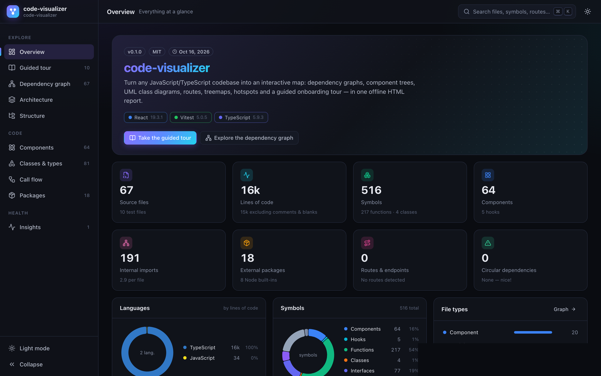
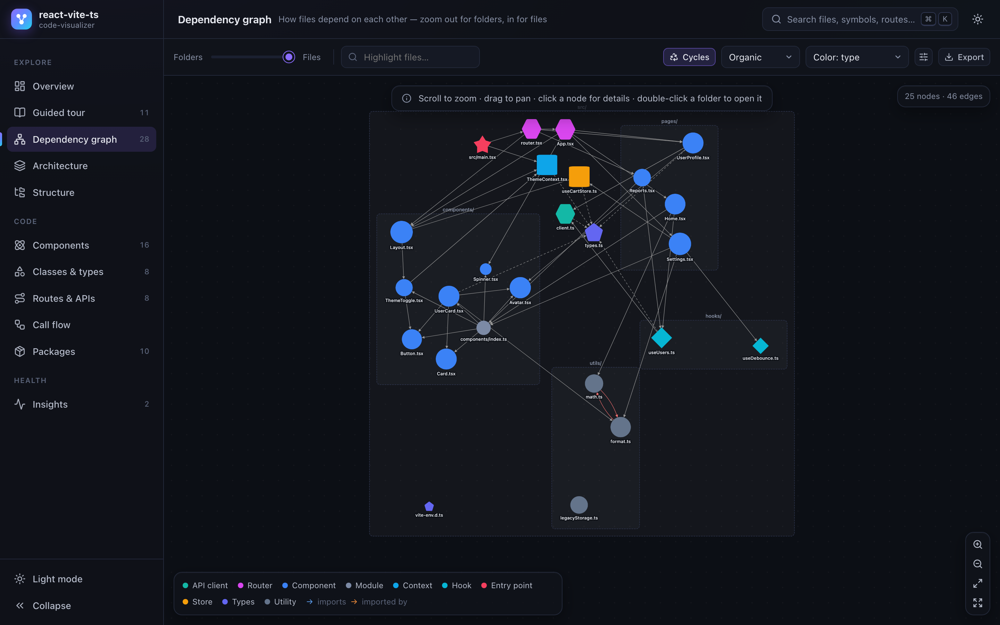
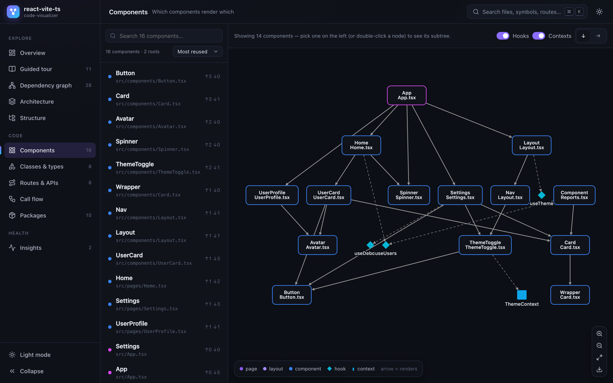
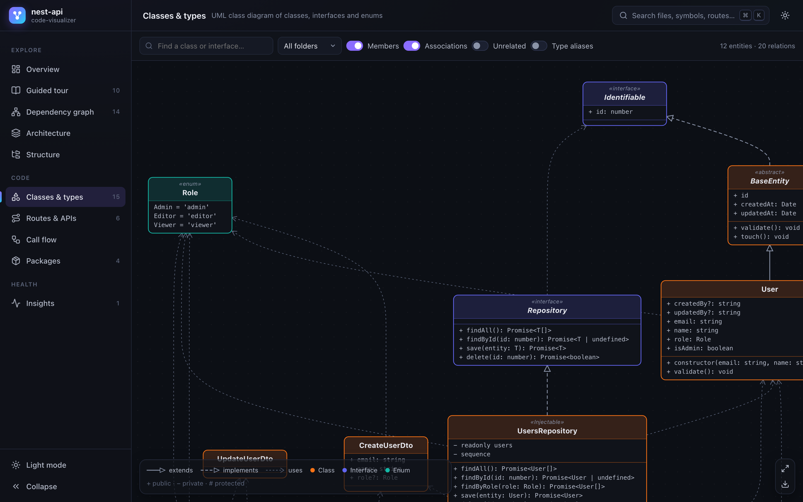
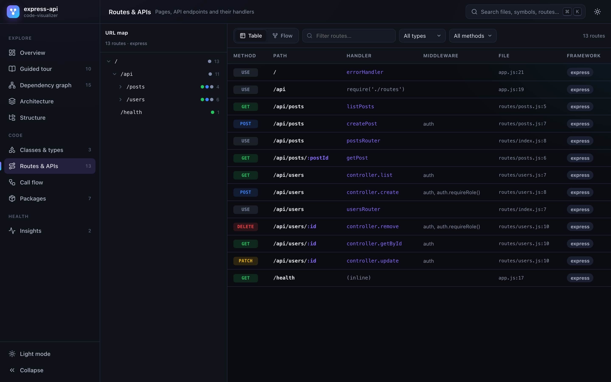
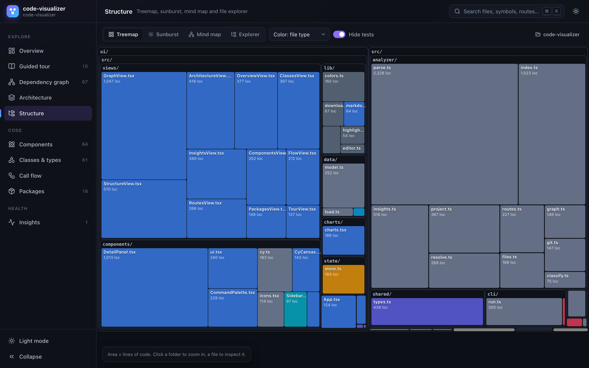
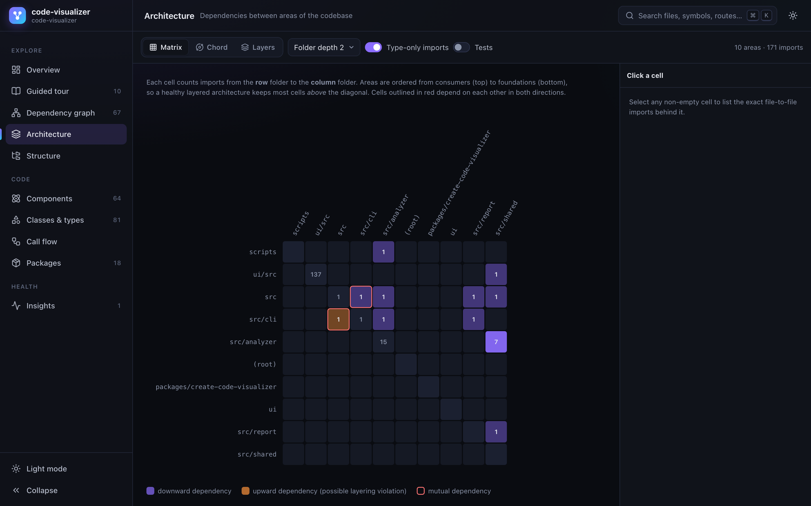
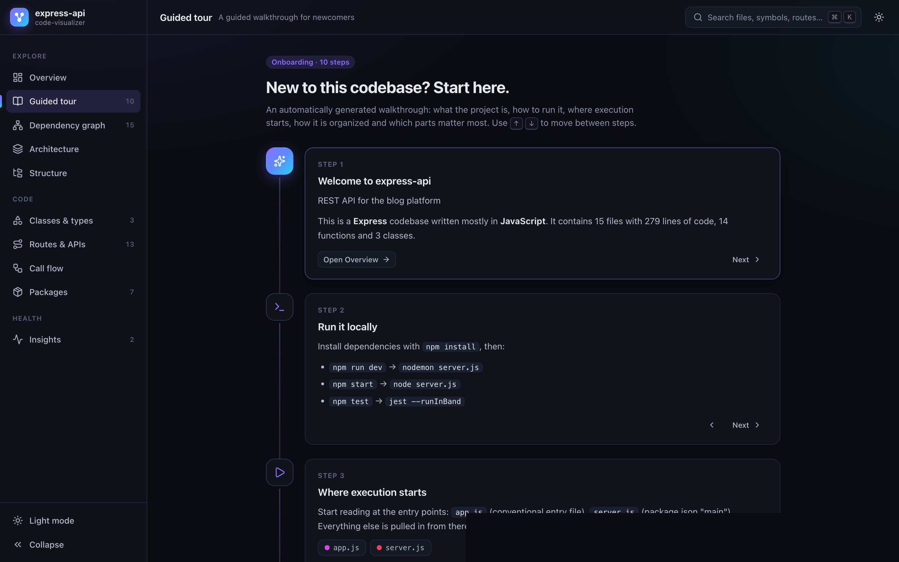
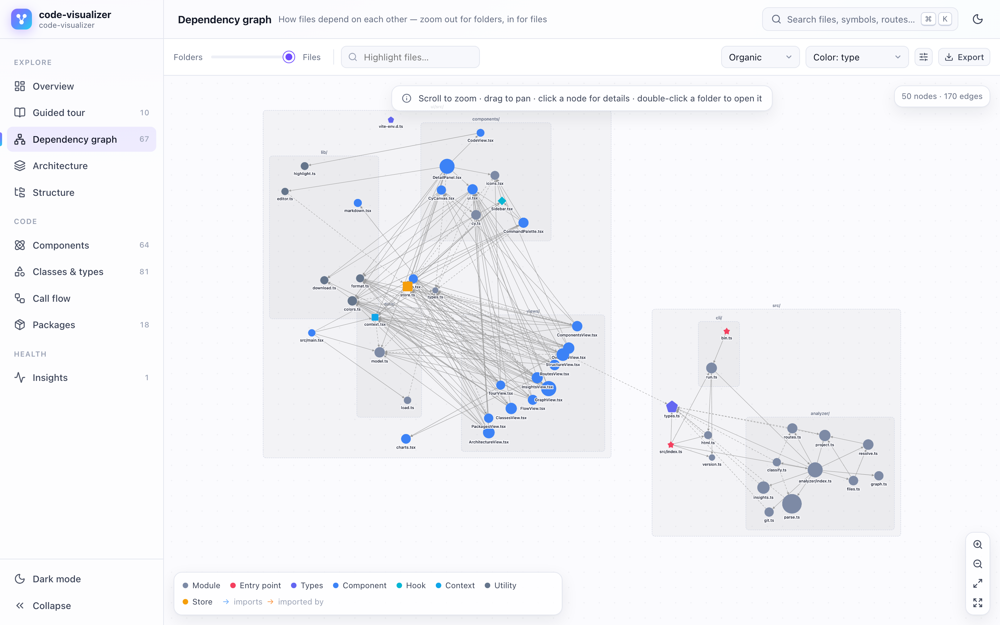
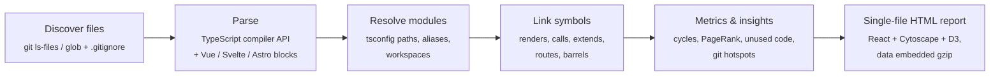

<div align="center">

# ◆ code-visualizer

**See any JavaScript / TypeScript codebase at a glance.**

One command turns your project into an interactive, offline map: dependency graphs you can zoom from folders down to functions, component trees, UML class diagrams, route maps, treemaps, hotspots — and a guided tour for developers who are new to the code.

[](https://www.npmjs.com/package/code-visualizer)
[](./LICENSE)
[](./package.json)

```bash
npx code-visualizer
```



</div>

---

## Table of contents

- [Why?](#why)
- [Quick start](#quick-start)
- [What you get](#what-you-get)
- [Usage](#usage)
- [What it understands](#what-it-understands)
- [Tips & tricks](#tips--tricks)
- [Privacy & sharing](#privacy--sharing)
- [Programmatic API](#programmatic-api)
- [How it works](#how-it-works)
- [FAQ & troubleshooting](#faq--troubleshooting)
- [Roadmap](#roadmap)
- [Contributing](#contributing)

## Why?

Joining a project means answering the same questions again and again:

- *Where does the app start, and how do I run it?*
- *Which files are the important ones? What can I safely ignore?*
- *Which component renders this? Who calls this function? What breaks if I change it?*
- *Which routes exist and which handler serves them?*
- *Where is the scary code — complex, frequently changed, tangled in cycles?*

`code-visualizer` answers them in seconds. It statically analyzes your code (nothing is executed, nothing leaves your machine) and writes **a single self-contained HTML file** that opens in your browser. Share it with a teammate, attach it to a pull request, or keep it as living documentation.

## Quick start

No installation needed — run it in the root of any JS/TS project:

```bash
npx code-visualizer
```

…or with `npm create`:

```bash
npm create code-visualizer
```

The report is written to `.code-visualizer/report.html` (a `.gitignore` is created inside that folder, so it never ends up in your commits) and opened in your default browser.

Focus on just one part of a codebase:

```bash
# A single file: everything it needs, and everything that depends on it
npx code-visualizer report --file=src/libs/index.ts

# One directory (imports in and out of it are shown as context)
npx code-visualizer report --directory=src/components/area-chart
```

> **Requirements:** Node.js 20 or newer. Works on macOS, Linux and Windows. `git` is optional (it unlocks history-based insights).

## What you get

| View | What it shows |
| --- | --- |
| **Overview** | Project at a glance: detected frameworks, languages, file & symbol statistics, areas of the codebase, the most important files, a health check, git activity and the npm scripts you can run. |
| **Guided tour** | An auto-generated onboarding walkthrough: what the project is, how to run it, where execution starts, how the code is organized, the core building blocks, routes, state & data, the domain model, the risky parts — and a **suggested reading order**. |
| **Dependency graph** | Every file and its imports. **Semantic zoom**: slide from top-level folders down to individual files, double-click a folder to open it. Focus on a file's neighbourhood, show the **impact** (blast radius) of changing it, find the **import path** between two files, highlight **circular dependencies**, color by type / folder / complexity / churn / age, export PNG, Mermaid, DOT or JSON. |
| **Architecture** | A **dependency matrix** (DSM) between areas that reveals layering violations, a **chord diagram** of how areas talk to each other, and a **layered graph** of folder-level dependencies. |
| **Structure** | A zoomable **treemap** (size = lines of code), a **sunburst**, an expandable **mind map** (folders → files → symbols) and a file **explorer** with metrics. |
| **Components** | The React / Vue / Svelte / Angular / Astro **component tree** — who renders whom, with the hooks and contexts each component uses. Click any component to see its props, hooks, children and parents. |
| **Classes & types** | A **UML class diagram** of classes, interfaces, enums and type aliases with members, visibility, decorators, `extends`, `implements` and associations. Export as SVG. |
| **Routes & APIs** | Every page and endpoint as a URL map and table — **Express, Fastify, Koa, Hono, NestJS, Next.js, Nuxt, SvelteKit, Remix, Astro, React Router, Vue Router, Angular** — with full paths (router mounts are resolved), middleware and handlers, plus a **request flow** diagram: route → middleware → handler → what it calls. |
| **Call flow** | A function-level **call graph**: callers and callees of any function or method, or every call inside a file. Understands `this.service.method()` in NestJS-style dependency injection. |
| **Packages** | Which npm packages are used where, how much, and which ones are **declared but never imported** or **imported but missing** from `package.json`. |
| **Insights** | **Hotspots** (complexity × change frequency), circular dependencies, the most complex functions, **unused exports**, orphan files, large files and hubs, **change coupling** (files that always change together), duplicate names and all TODO / FIXME notes. |

And everywhere:

- **⌘K / Ctrl+K search** across files, components, functions, classes, routes, packages and folders.
- **Detail panel** for any file, symbol, folder, package or route: metrics, git history, imports / used-by, outline, exports, syntax-highlighted source, and an **“Open in VS Code / Cursor / WebStorm / Zed”** button that jumps to the exact line.
- **Deep links** — every view and selection is in the URL (`report.html#/graph?sel=file:src/app.ts`).
- Dark & light themes, keyboard friendly, responsive down to phone size.

<table>
  <tr>
    <td></td>
    <td></td>
  </tr>
  <tr>
    <td align="center"><b>Dependency graph</b> — files grouped by folder, shaped by type, cycles in red</td>
    <td align="center"><b>Component tree</b> — who renders whom, plus hooks and contexts</td>
  </tr>
  <tr>
    <td></td>
    <td></td>
  </tr>
  <tr>
    <td align="center"><b>UML class diagram</b> — inheritance, interfaces and associations</td>
    <td align="center"><b>Routes & APIs</b> — every endpoint with its full mounted path</td>
  </tr>
  <tr>
    <td></td>
    <td></td>
  </tr>
  <tr>
    <td align="center"><b>Treemap</b> — where the code lives</td>
    <td align="center"><b>Dependency matrix</b> — how areas depend on each other</td>
  </tr>
  <tr>
    <td></td>
    <td></td>
  </tr>
  <tr>
    <td align="center"><b>Guided tour</b> — onboarding generated from the code</td>
    <td align="center"><b>Light theme</b></td>
  </tr>
</table>

## Usage

```text
code-visualizer [command] [root] [options]
```

`report` is the default command, so `npx code-visualizer` and `npx code-visualizer report` are the same. `root` defaults to the current directory.

| Option | Description |
| --- | --- |
| `-f, --file <path>` | Focus on one file: its dependencies (all levels) and the files that depend on it (2 levels by default). |
| `-d, --directory <path>` | Focus on one directory. Files it imports from — and files importing it — are shown as context. Alias: `--dir`. |
| `--depth <n>` | With `--file`: how many levels of dependencies and dependents to include. |
| `-o, --output <path>` | Where to write the report: a `.html` file or a directory. Default: `<root>/.code-visualizer/report.html`. |
| `-e, --exclude <glob>` | Exclude files using `.gitignore` syntax. Repeat the flag or comma-separate patterns. |
| `--json` | Also write the raw analysis as JSON next to the report (great for scripts and CI). |
| `--no-open` | Don't open the browser (it is also skipped automatically when `CI` is set). |
| `--no-git` | Skip git history (churn, ownership, hotspots, change coupling). |
| `--no-source` | Don't embed source code in the report (smaller file, safer to share). |
| `--max-files <n>` | Safety limit for huge repositories (default `20000`). |
| `-q, --quiet` | Only print errors. |
| `-h, --help` / `-v, --version` | Help and version. |

### Examples

```bash
# Analyze another folder (e.g. one app of a monorepo)
npx code-visualizer report ./apps/web

# Write the report somewhere else and don't open it
npx code-visualizer report --output=docs/architecture.html --no-open

# Ignore generated code and skip git history
npx code-visualizer report --exclude "**/*.generated.ts" --exclude "src/legacy/**" --no-git

# Produce JSON for your own tooling
npx code-visualizer report --json --no-open
```

### Using `npm create`

`npm create code-visualizer` runs the same CLI. When you pass options through `npm create`, put them after `--` so npm forwards them:

```bash
npm create code-visualizer@latest -- report --file=src/libs/index.ts
npm create code-visualizer@latest -- report --directory=src/components/area-chart
```

### Installing it (optional)

```bash
npm install --save-dev code-visualizer
```

```jsonc
// package.json
{
  "scripts": {
    "visualize": "code-visualizer"
  }
}
```

## What it understands

**Languages:** TypeScript, JavaScript (ESM and CommonJS), JSX/TSX, Vue single-file components, Svelte and Astro components.

**Frameworks & libraries** (auto-detected from `package.json`): React, Next.js, Remix / React Router, Vue, Nuxt, Svelte, SvelteKit, Astro, Angular, SolidJS, Preact, Qwik, Lit, React Native & Expo, Electron, Express, Fastify, Koa, Hono, NestJS, tRPC, GraphQL, Prisma, Drizzle, Mongoose, TypeORM, Redux, Zustand, Pinia, MobX, Jotai, TanStack Query, Tailwind CSS, styled-components, Vite, webpack, Vitest, Jest, Playwright, Storybook and more.

<details>
<summary><b>Symbols</b></summary>

- **Components:** function & arrow components, `memo`, `forwardRef`, `observer`, higher-order components (`connect(...)(Comp)`), `lazy` / `dynamic` components, styled-components, React class components, Vue SFCs (`<script setup>` with `defineProps` / `defineEmits`, Options API, `defineComponent`), Svelte (4 & 5 props), Astro, Angular `@Component`.
- **Hooks & composables** (`useX`), functions, classes (properties, methods, constructors, parameter properties, visibility, `static`, `abstract`, decorators), interfaces, type aliases, enums, constants, variables and namespaces.
- **Tags:** React contexts, stores (Redux Toolkit, Zustand, Pinia, Jotai, …), schemas (Zod, Yup), models (Mongoose, Drizzle, TypeORM), Next.js server actions and `'use client'` files.
- **Relations:** imports, re-exports through barrel files, *renders*, *calls*, *instantiates*, *extends*, *implements*, *uses* (type associations, context usage).
- Cyclomatic complexity, lines of code, JSDoc summaries and leading file comments.

</details>

<details>
<summary><b>Module resolution</b></summary>

Relative imports, `index` files, TypeScript ESM style (`./foo.js` → `foo.ts`), `tsconfig.json` / `jsconfig.json` `paths` and `baseUrl` (including nested configs, `extends` and `tsconfig.app.json`-style references), Vite / webpack / Nuxt aliases, the common `@/`, `~/`, `#/` and `$lib/` conventions, npm/yarn/pnpm **workspaces** in monorepos, CommonJS `require`, dynamic `import()`, Nuxt auto-imported components and SvelteKit's generated `$types`. Your `node_modules` don't need to be installed.

</details>

<details>
<summary><b>Routes</b></summary>

- **File-based:** Next.js app router (`page`, `layout`, `route.ts` methods, route groups, dynamic segments, `middleware.ts`) and pages router (incl. `pages/api`), Nuxt (`pages/`, `layouts/`, `server/api`), SvelteKit (`+page`, `+layout`, `+server`), Remix / React Router v7 flat routes, Astro pages & endpoints.
- **Code-based:** Express / Koa / Hono / Fastify routers including `app.use('/prefix', router)` mounts across files, `router.route('/x').get().post()` chains and `fastify.route({...})`, NestJS `@Controller` + `@Get/@Post/…` (and GraphQL resolvers), React Router `<Route>` trees and `createBrowserRouter` objects, Vue Router and Angular route configs (with lazy `import()` targets).

</details>

<details>
<summary><b>Insights</b></summary>

Circular dependencies (Tarjan's strongly connected components on runtime imports), PageRank-style file importance, fan-in / fan-out / instability, transitive impact, orphan files, unused exports (following re-export chains, ignoring entry points and framework files), unused and missing dependencies, complexity hotspots, git churn, authorship, change coupling, duplicate exported names and TODO / FIXME / HACK comments.

</details>

## Tips & tricks

- **Start with the Guided tour** when you are new to a project, then follow the suggested reading order.
- In the **dependency graph**, drag the *Folders ↔ Files* slider to zoom semantically; double-click a folder to open it and a folder box to close it; double-click a file to focus on it.
- Select a file and press **Impact** to see everything that could break if you change it.
- **Path to…** then click a second file to see how two modules are connected.
- Switch *Color* to **churn** or **last change** to see where the team is actively working.
- Keyboard: <kbd>⌘K</kbd>/<kbd>Ctrl K</kbd> or <kbd>/</kbd> search · <kbd>1</kbd>–<kbd>9</kbd> switch views · <kbd>Esc</kbd> close panels · <kbd>↑</kbd>/<kbd>↓</kbd> move through the tour.
- Add `?theme=light` or `?theme=dark` to the report URL to force a theme.
- Power users: after opening the dependency graph, `window.__CODE_VISUALIZER__` in the browser console exposes the [Cytoscape](https://js.cytoscape.org/) graph instance and the full analysis model.

## Privacy & sharing

- Everything runs **locally**. Your code is parsed on your machine and **never uploaded**; the report makes no network requests.
- The report is a single HTML file that works offline, so it is easy to share or attach to a PR.
- By default the report **embeds your source code** (so you can read files in the browser) and **git author names**. Before sharing outside your team, consider `--no-source` and `--no-git`. The project's absolute path is stored for the "open in editor" links.

## Programmatic API

```ts
import { analyze, writeReport } from 'code-visualizer';

const data = await analyze({
  root: process.cwd(),
  directory: 'src/features/checkout', // optional, or `file: 'src/app.ts'`
  git: true,
  includeSource: false,
});

console.log(`${data.stats.files} files, ${data.insights.cycles.length} circular dependencies`);
writeReport(data, 'reports/code-map.html', { json: true });
```

The full data model (`ReportData`, `FileInfo`, `SymbolInfo`, `RouteInfo`, …) is exported as TypeScript types.

## How it works



Parsing uses the TypeScript compiler's parser only (no type checking), so it is fast: a few hundred files take well under a second, and a synthetic 4,000-file project is analyzed in about half a second on a laptop. See [docs/ARCHITECTURE.md](docs/ARCHITECTURE.md) for details.

## FAQ & troubleshooting

<details>
<summary><b>Some imports show up as “unresolved”.</b></summary>

Check that the alias is declared in `tsconfig.json`/`jsconfig.json` `paths` or in your Vite/webpack config. Unresolved specifiers are listed in each file's *Imports* tab, which helps to spot the missing alias.
</details>

<details>
<summary><b>The graph is too big.</b></summary>

Use the *Folders ↔ Files* slider, hide tests/config in the graph settings, or generate a focused report with `--directory` or `--file`. You can also `--exclude` generated or vendored code.
</details>

<details>
<summary><b>A dependency is flagged as unused, but we need it.</b></summary>

The check only looks at runtime `dependencies` that no analyzed source file imports. Packages used only by CLIs, configs or framework conventions (e.g. database drivers loaded by an ORM) can be reported. Treat the list as a hint.
</details>

<details>
<summary><b>Does it work with monorepos?</b></summary>

Yes. Workspaces from `package.json`, `pnpm-workspace.yaml` and `lerna.json` are detected and imports between packages are linked to their sources. Run it at the repository root for the whole picture, or point it at one package: `npx code-visualizer report packages/ui`.
</details>

<details>
<summary><b>Where are my git insights?</b></summary>

They require running inside a git repository with history. Shallow CI clones (`fetch-depth: 1`) have little history; use `fetch-depth: 0` for meaningful hotspots.
</details>

## Roadmap

`report` is the first of several commands. Ideas on the list — contributions welcome:

- `code-visualizer check` — CI quality gates (fail on new cycles, missing dependencies, complexity budgets).
- `code-visualizer diff <base>` — visualize what a branch or pull request changes in the architecture.
- `--watch` mode with live reload while you code.
- Markdown / Mermaid / PlantUML exports for documentation sites.
- Editor integrations (VS Code extension).

## Contributing

Bug reports, ideas and pull requests are very welcome — see [CONTRIBUTING.md](CONTRIBUTING.md) to get started (it takes one `npm install`).

## License

[MIT](LICENSE) © Asfandiyar Khan
