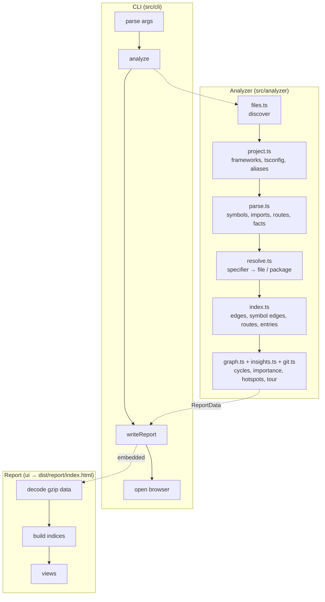

# Architecture

`code-visualizer` has two halves that only meet through one JSON document, [`ReportData`](../src/shared/types.ts):

1. **The analyzer** (Node.js, `src/analyzer`) reads a project and produces `ReportData`.
2. **The report UI** (React, `ui/`) is pre-built into a single HTML file. The CLI injects `ReportData` into it and writes the result to disk.

## Analyzer

### 1. Discovery (`files.ts`)

Inside a git repository, `git ls-files --cached --others --exclude-standard` gives exactly the files developers see (all nested `.gitignore` rules applied). Outside git — or when the folder is ignored by a parent repository — `tinyglobby` plus the root `.gitignore` is used. Build output, dependencies and caches (`node_modules`, `dist`, `.next`, `coverage`, …) are always skipped, as are minified bundles and files over 1.5 MB.

### 2. Project context (`project.ts`)

Reads `package.json` (and every workspace package), detects frameworks from declared dependencies, finds every `tsconfig*.json` / `jsconfig*.json` (parsed with the TypeScript API so `extends` works), extracts aliases from Vite/webpack/Nuxt configs and collects entry files referenced by npm scripts and `index.html`.

### 3. Parsing (`parse.ts`)

Each file is parsed once with `ts.createSourceFile` — the parser only, no type checker, so it is fast and needs no `node_modules`. Vue, Svelte and Astro files are split into their script blocks (with line offsets preserved) and their templates are scanned for component tags.

A visitor collects:

- **Imports** (static, dynamic, `require`, `import x = require()`), local bindings and **exports / re-exports**, including CommonJS `module.exports`.
- **Symbols**: components (with props, hooks, rendered children, contexts), hooks, functions, classes (members, decorators, heritage), interfaces, types, enums, constants and variables, each with location, complexity and JSDoc summary.
- **Facts** used later for linking: call expressions (`foo()`, `ns.foo()`, `this.repo.save()`, `new Foo()`), type references and field types.
- **Routes** declared in code: Express-style routers, NestJS decorators, React Router / Vue Router / Angular configs.
- TODOs, directives (`'use client'`), lines of code and cyclomatic complexity.

### 4. Resolution (`resolve.ts`)

Each import specifier is resolved against the in-memory file set: relative paths, extension and `index` probing, `.js → .ts` rewriting, tsconfig `paths`/`baseUrl` from the nearest config, workspace packages (mapping `dist` entries back to `src`), bundler aliases and common conventions (`@/`, `~/`, `$lib/`). Everything else becomes an external package, a Node built-in, an asset or "unresolved".

### 5. Linking (`index.ts`)

- File **edges** are merged per pair of files (kinds, type-only flag, imported names).
- **Export resolution** follows `export { x } from` and `export * from` chains so that symbols imported through barrel files point at their real definition.
- **Symbol edges**: `renders` (JSX/template tags), `calls` (including methods through `this.field` types and module-level instances), `instantiates`, `extends`, `implements` and `uses`.
- **Routes**: file-system routes (`routes.ts`) are merged with code routes; Express `app.use('/prefix', router)` mounts are followed across files to compute full paths.
- **Entries** come from `package.json` fields, scripts, `index.html`, build configs and naming conventions.

### 6. Metrics & insights

- `graph.ts`: Tarjan's SCC on runtime (non type-only) edges finds circular dependencies; PageRank over imports estimates importance.
- Unused exports are computed by propagating "used" names through import edges and re-export chains; entry points, framework files, tests and configs count as used.
- `git.ts` reads up to 4,000 commits once (`git log --name-only`) for churn, authors, weekly activity and change coupling.
- `insights.ts` builds folder summaries and the onboarding **tour** from all of the above.

### 7. Scoping

`--file` and `--directory` analyze the **whole** project (so dependents and resolution are correct) and then keep the requested subset, marking each file's role (`focus`, `dependency`, `dependent`, `member`, `context`).

## Report UI

- Built with Vite + React into **one** HTML file (`vite-plugin-singlefile`), so reports work from `file://`, offline, and can be shared as an attachment.
- The CLI embeds the data as gzip + base64 (`<script id="cv-data">`); the UI decompresses it with the browser's `DecompressionStream`.
- `ui/src/data/model.ts` builds lookup indices once (files, symbols incl. `Class.method` ids, in/out edges, folder tree, routes).
- State lives in a tiny store (`ui/src/state/store.ts`) mirrored to the URL hash for deep links and back/forward navigation.
- Graphs use [Cytoscape.js](https://js.cytoscape.org/) (fCoSE and dagre layouts); treemap, sunburst, mind map, chord, matrix and charts use [D3](https://d3js.org/) for math and React for rendering; the UML diagram uses [dagre](https://github.com/dagrejs/dagre) for layout and SVG for drawing.

### Semantic zoom

The dependency graph never renders more than it should. Each file is mapped to a *representative*: the first ancestor folder that is collapsed, or the file itself if all of its ancestors are expanded. Moving the *Folders ↔ Files* slider expands every folder above a depth; double-clicking opens or closes one folder. Edges are aggregated between representatives, so zooming out turns hundreds of file edges into a handful of folder dependencies. Pass-through folders (like a lone `src/`) are opened automatically.

## Design principles

- **Zero config.** Sensible detection over options; options exist only to narrow or protect.
- **Local and private.** No network calls, no telemetry; the report is a static file.
- **Fast.** Parse without type-checking, resolve in memory, compute everything in one pass.
- **Useful first.** Every view answers a question developers actually ask when they open an unfamiliar codebase.
