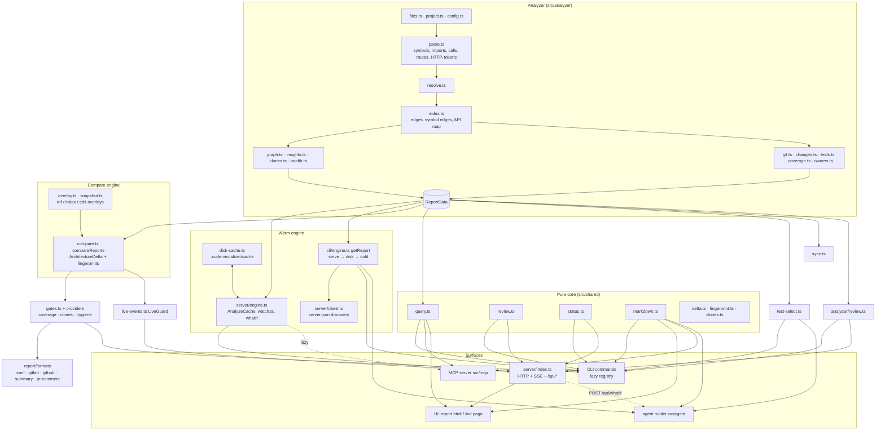

# Architecture

`code-visualizer` is one analyzer with many thin surfaces. Everything meets in one JSON document, [`ReportData`](../src/shared/types.ts):

1. **The analyzer** (Node.js, `src/analyzer`) reads a project (its code, git history, tests, coverage, owners and configuration) and produces `ReportData`. It can analyze the working tree, any git ref, the staged index or a proposed edit.
2. **Three shared engines** sit on top of it:
   - the **warm engine** (`src/server/engine.ts`, `src/analyzer/disk-cache.ts`, `src/cli/engine.ts`): a persistent parse and git cache, a file watcher, and reuse of a running `serve`;
   - the **compare engine** (`src/analyzer/overlay.ts`, `snapshot.ts`, `compare.ts`): analyses of other versions without a checkout, and `compareReports` → `ArchitectureDelta` with stable finding fingerprints;
   - the **query core** (`src/shared/query.ts`): pure reachability questions (impact, uses, who, path, route, tests).
3. **The surfaces** are thin layers over those engines: the report UI (`ui/`), the live server (`src/server`), the CLI commands (`src/cli/commands`), the gates and CI formats (`src/analyzer/gates.ts`, `src/report/formats`), the MCP server (`src/mcp`) and the agent hooks (`src/agent`).

Code in `src/shared/` is pure (no Node APIs), so the CLI, the server, the MCP server, the hooks and the browser UI compute the same answers from the same functions.

## Analyzer

### 1. Discovery (`files.ts`)

Inside a git repository, `git ls-files --cached --others --exclude-standard` gives exactly the files developers see (all nested `.gitignore` rules applied). Outside git, or when git lists files but none of them is source code (for example inside an ignored folder), `tinyglobby` plus the root `.gitignore` is used. Build output, dependencies and caches (`node_modules`, `dist`, `.next`, `coverage`, `.code-visualizer`, …) are always skipped, as are minified bundles and files over 1.5 MB. Each file's size and modification time are recorded for the cache. The source extensions live in `src/shared/source-files.ts`, a module with no imports, so the agent hook's no-op path can check a path without loading anything else.

### 2. Project context (`project.ts`, `config.ts`)

Reads `package.json` (and every workspace and nested package), detects frameworks from declared dependencies, finds every `tsconfig*.json` / `jsconfig*.json` (parsed with the TypeScript API so `extends` works), extracts aliases from Vite/webpack/Nuxt configs and collects entry files referenced by npm scripts, tool configs and `index.html`. Packages nested inside `test/`, `fixtures/`, `examples/`… are separate programs and left out unless `includeSubprojects` says otherwise. `ProjectInfo.testRunners` records the unit and e2e runner of each workspace package.

`config.ts` loads the optional configuration from `code-visualizer.config.json`, `.code-visualizerrc(.json)` or `package.json#codeVisualizer` with a light JSON-with-comments parser (TypeScript is loaded only to explain an invalid file). Each feature owns a block of keys (`rules`, `layers`, `check.*`, `serve`, `coverage`, `clones`, `includeSubprojects`); `normalizeConfig` accepts the shorthand forms, and unknown `check.*` keys get a suggestion. A file that exists but can't be parsed is never ignored silently: `loadConfig()` returns an `error` with the position.

All file reads go through `readtext.ts`, so a snapshot can substitute another version of any file (see [Compare engine](#compare-engine)).

### 3. Parsing (`parse.ts`)

Each file is parsed once with `ts.createSourceFile`: the parser only, no type checker, so it is fast and needs no `node_modules`. Vue, Svelte and Astro files are split into their script blocks (with line offsets preserved) and their templates are scanned for component tags.

A visitor collects:

- **Imports** (static, dynamic, `require`, `import x = require()`), local bindings and **exports / re-exports**, including CommonJS `module.exports`.
- **Symbols**: components (with props, hooks, rendered children, contexts), hooks, functions, classes (members, decorators, heritage), interfaces, types, enums, constants and variables, each with location, cyclomatic and cognitive complexity (inline callbacks measured on their own), JSDoc summary and `@deprecated` tag.
- **Facts** used later for linking: call expressions (`foo()`, `ns.foo()`, `this.repo.save()`, `new Foo()`) with their **lines and argument counts** (at most 20 per callee), type references and field types.
- **Routes** declared in code: Express-style routers, NestJS controllers and GraphQL resolvers, React Router / Vue Router / Angular configs.
- **HTTP calls**: `fetch`-like functions, `useSWR`, axios/ky/got/ofetch clients, Angular `HttpClient` and supertest; in tests also **URL visits** (`page.goto`, `cy.visit`, `cy.request`, `browser.url`, Playwright `request`).
- A **token stream** for clone detection (identifiers → `I`, literals → `L`, imports left out), cached with the parse result.
- TODOs, directives (`'use client'`), lines of code.

### 4. Resolution (`resolve.ts`)

Each import specifier is resolved against the in-memory file set: relative paths, extension and `index` probing, `.js → .ts` rewriting, tsconfig `paths`/`baseUrl` from the nearest config, workspace packages (mapping `dist` entries back to `src`), bundler aliases and common conventions (`@/`, `~/`, `$lib/`). Everything else becomes an external package (checked against the **nearest** `package.json`), a Node built-in, an asset or "unresolved".

### 5. Linking (`index.ts`, `apimap.ts`)

- File **edges** are merged per pair of files (kinds, type-only flag, imported names).
- **Export resolution** follows `export { x } from` and `export * from` chains so that symbols imported through barrel files point at their real definition.
- **Symbol edges**: `renders`, `calls` (including methods through `this.field` types and module-level instances), `instantiates`, `extends`, `implements` and `uses`, each with the call-site `lines` and `argc`.
- **Routes**: file-system routes (`routes.ts`) are merged with code routes; Express `app.use('/prefix', router)` mounts are followed across files to compute full paths.
- **API map** (`apimap.ts`, `src/shared/route-match.ts`): every HTTP call is scored against every route (method, static segments, parameters, catch-alls, base-URL prefixes); the best match links the calling symbol to the route handler, so call flow can cross from the frontend into the backend.
- **Entries** come from `package.json` fields, scripts, `index.html`, build configs and naming conventions.

### 6. Metrics & insights (`graph.ts`, `insights.ts`, `clones.ts`)

- Tarjan's SCC (`src/shared/scc.ts`, iterative) on runtime edges finds circular dependencies; PageRank over imports estimates importance.
- Unused exports are computed by propagating "used" names through import edges and re-export chains; entry points, framework files, tests and configs count as used.
- `insights.ts` builds folder summaries, the onboarding **tour** and the list of insights (hotspots, complex functions, orphans, devDependencies in production code, deprecated usages, …).
- **Clones** (`clones.ts`): winnowed Rabin-Karp fingerprints over the token streams find copies that survive renamed identifiers and changed literals. Matches are attributed to declarations, chained across small edits and grouped into families with union-find; fingerprints found in too many declarations count as boilerplate and are skipped. Clone pairs between unchanged files are reused across analyses. `src/shared/clones.ts` turns families into messages, `cloneDelta` (new / fixed / drifted families between two analyses) and `cloneDrift` (a change that edited one copy but not the others).

### 7. Git, people, tests and coverage (`git.ts`, `owners.ts`, `tests.ts`, `coverage.ts`)

- `analyzeGit()` reads up to 4,000 commits once with `git log --numstat --relative --no-renames` (`.mailmap` applied, names that share an email merged): per file the commits, authors (with a recency-weighted ownership share), first and last change and recent commit messages; per project the contributors and their areas, weekly and daily activity and **change coupling**.
- `owners.ts` parses `CODEOWNERS` (last matching rule wins, gitignore-style patterns).
- `tests.ts` builds the **test map**: starting from every test file, it walks the import graph and records which source files each test reaches. Together with URL visits matched to routes, and the coverage report, this gives one rule for "reached by a test" (`query.testEvidence`, `query.untestedChanges`).
- `coverage.ts` reads istanbul `coverage-final.json` and `lcov.info` (root and each workspace package), maps their paths onto analyzed files, sets per-file and project line coverage, and computes **patch coverage** of the added lines.
- Every git invocation that takes a user ref goes through `resolveCommit` (`git.ts`) or `verifyCommit` (`sync.ts`), which reject option-like refs; `refHint` adds "Did you mean …?" for typos and refs that only exist on `origin`.

### 8. Your changes (`git.ts` → `changes.ts`)

`analyzeChanges()` decides what "your work" is:

- **Branch mode**: `HEAD` has commits that are not on the base branch (`--base`, config `base`, the CI target branch, `origin/HEAD`, `main`, `master`, `develop` or `trunk`): everything since the merge-base, including uncommitted work.
- **Trunk mode**: on the base branch with unpushed commits, the merge-base with `@{u}`.
- **Working mode**: otherwise, staged, unstaged and untracked changes against `HEAD`.
- **Head mode** (`analyze({ head, overlay })`): the changes of another ref since its merge-base, read straight from git (used by `review`).

It parses the unified diff into changed lines and recognises **comment-only** hunks. `buildChangeSet()` maps changed lines to the **symbols** they touch, follows the reverse import and call graph to the **impacted** files and routes (symbol-precise when the edit sits inside declarations), selects the **tests** (the same selection as `code-visualizer test`), patch coverage, clone drift, suggested **reviewers**, **CODEOWNERS**, a **risk score** with its factors, and the **reading order** (`src/shared/review.ts`).

With `compare: true`, `analyze()` also attaches `changes.delta`: the comparison with a snapshot of the base commit.

### 9. Health and history (`health.ts`)

`computeHealth()` scores weighted categories (modularity, complexity, size, dead code, dependencies, tests, which become *Tests & coverage* when a coverage report exists, knowledge on git only, and duplication) into a 0–100 score with grade A–E, plus **improvements** ranked by their expected gain. Each `report` / `serve` run appends a `HistoryPoint` to `.code-visualizer/history.json` (deduplicated for unchanged commits, capped at 500 points).

### 10. Scoping

`--file` and `--directory` analyze the **whole** project (so dependents and resolution are correct) and then keep the requested subset, marking each file's role (`focus`, `dependency`, `dependent`, `member`, `context`).

### 11. Developer tools (`repo.ts`, `workflows.ts`, `ai.ts`)

Three optional readers, each behind its own `AnalyzeOptions` flag (`repo`, `ci`, `ai`; `serve` and `report` turn them on) and each a thin Node layer over a pure module in `src/shared`, which the UI and the CLI also import:

- **`repo.ts`** runs a handful of `git` processes (`for-each-ref`, `stash list`, `worktree list`, `reflog`, `ls-tree`, `count-objects`, `config --list`) and hands their text to the parsers in `shared/git-insights.ts`, which decide what is merged, gone, unpushed, stale, lost or worth a setting. Only the part that depends on HEAD (the tree and the commit style) is memoized; branch and stash state is read every time. `listBranches` is exported separately so the branch-deletion endpoint can check the current state without a full analysis.
- **`workflows.ts`** reads `.github/workflows`, local actions and `dependabot.yml` as plain files; `shared/yaml.ts` is a small YAML-subset reader that keeps line numbers (no dependency), and `shared/workflows.ts` turns each file into triggers, jobs and steps and runs the rules (`WORKFLOW_RULES`). `shared/workflow-forecast.ts` applies GitHub's branch, tag and path filter rules to a push or pull request, and orders jobs into columns for the graph.
- **`ai.ts`** lists Claude Code items (memory files, skills, commands, subagents, MCP servers, hooks, plugins) from the project and, unless `personal: false`, from `~/.claude`. It keeps names, descriptions and paths; `shared/ai.ts` parses the front matter and runs the readiness checks, `shared/ai-guide.ts` holds the usage guide and the templates.

## Warm engine

Every surface asks for an analysis through the cheapest path that is still correct.

- **Disk cache** (`disk-cache.ts`): parse results (with tokens) in `.code-visualizer/cache/parse-*.json.gz`, reused when a file's mtime and size match, or its content hash after a checkout or a formatter; git analyses per HEAD. Files are written atomically and **signed with a per-user secret** in a private 0700 folder in the OS temp dir, so a cache that comes with a repository is never trusted. `--no-cache` and `CODE_VISUALIZER_NO_CACHE=1` bypass it.
- **Engine** (`src/server/engine.ts`): one in-memory `AnalyzeCache`, a coalescing re-analysis queue and listeners. `mode: 'eager'` re-analyzes shortly after a change (serve); `mode: 'lazy'` only marks the analysis dirty and re-analyzes on the next `current()` (MCP). `whatIf(file, text)` or `whatIf(overlay)` analyzes a proposed edit through an overlay on the same warm cache, without git or history.
- **Watching** (`src/server/watch.ts`): a recursive `fs.watch` on macOS and Windows; on Linux one watch per project folder (outside dependency, build and dot folders), following new folders. A watch on `.git` (`HEAD`, `index`, refs, `FETCH_HEAD`) catches commits, checkouts, staging and fetches. Events are debounced and coalesced.
- **Server discovery** (`src/server/client.ts`, `state.ts`): a running `serve` writes `.code-visualizer/server.json` (mode 0600) with its URL, token, pid and an options fingerprint. Clients trust it only when it is private and owned by the current user, verify the pid and root with `/api/ping`, and send the token only to loopback or the machine's own addresses.
- **`getReport()`** (`src/cli/engine.ts`): a matching running `serve` → the disk cache → a cold run. The analyzer (and the TypeScript compiler) is only loaded when the server cannot answer. Overlay runs never use the server.
- **Lazy CLI** (`src/cli/run.ts`): a registry of `{ name, aliases, summary, group, brief, load }` descriptors. `--help`, `--version` and light commands such as `status` never import the analyzer.
- **State** (`src/analyzer/state.ts`): `.code-visualizer/state.json` holds small sections owned by features (`lastCheck`, `lastTest`, `status`, `sync`, `lastVisit`, `agents`), read and written only through `readState` / `updateState` (atomic, with a best-effort lock). The file is ignored when git tracks it, when `.code-visualizer` is a symlink or when another user owns it.
- **Repository state without git** (`repo-state.ts`): HEAD, refs, packed-refs, the index mtime and the last fetch, read straight from `.git` (including linked worktrees) for status lines that run on every prompt.

## Compare engine

- **Overlays** (`overlay.ts`, `readtext.ts`): an overlay maps project paths to the text of another version (`null` = deleted). `overlayForRef(root, ref)` and `overlayForIndex(root)` build one from a single `git diff --raw -z` plus `git cat-file --batch`. Every other file is identical to the working tree by construction, so it is read from disk and its parse is reused (`AnalyzeCache.byHash`). Manifests (package.json, tsconfig, the configuration, CODEOWNERS…) are read through the overlay too, so a ref is judged by its own configuration (`configAt`).
- **Snapshots** (`snapshot.ts`): `snapshotAt(root, ref)` analyzes a commit through its overlay and caches the result per commit, in memory and in `.code-visualizer/snapshots/` (signed like the parse cache, newest 20 kept).
- **`compareReports(base, head)`** (`compare.ts`, pure): new and removed imports, new dependencies between areas (with the imports behind them), new and fixed cycles and rule violations (base violations re-judged with the head's configuration), export and API changes with importers and **stale call sites**, removed routes still called, packages, complexity increases, new unused exports, new / fixed / drifted clones and health per category. Renames (`renamesSince`) keep their findings' identity. Every finding has a **fingerprint** (`src/shared/fingerprint.ts`: FNV-1a over rule, file and subject, never a line number), so `fingerprints.new` / `fixed` / `worsened` are exact. With `changedFiles`, it compares only those files (the live guard's fast path).

`diff`, `pr`, `check --changed`, `review`, `sync`, the live guard, `/api/whatif` and the agent hooks are all `compareReports` over two analyses.

## Query core (`src/shared/query.ts`)

Pure functions over `ReportData` (or any `QueryData`), memoized per data object:

- `resolveTarget` turns a file, suffix, symbol (`useCart`, `Class.method`, `file#Symbol`), folder or route/URL into a target, with suggestions and alternatives.
- `impactOf` (symbol-precise, widening to file level with a reason), `usesOf`, `whoOf`, `importPath`, `routeFor`, `testsFor`, `callersOf`, `calleesOf`, `transitive`.
- Test reach in one place: `httpTestedFiles`, `routeTestReach`, `routesAffectedBy`, `testEvidence`, `untestedChanges`.

The CLI query commands (`src/cli/commands/query.ts`), the MCP tools, the agent hooks, My changes and the report UI's detail panel, call flow and graph all call these functions.

## Gates and CI formats

- **Gates** (`src/analyzer/gates.ts`, pure): `GATE_PROVIDERS` turn an analysis into `Finding`s with rule ids and fingerprints. Built in: rules, dependencies, cycles, complexity, no-worse, unused exports, health, health drop and risk; features append their own (`patchCoverageGate` in `coverage.ts`, `clonesGate` in `clones.ts`, `hygieneGate` in `hygiene.ts`). `evaluateGates(data, thresholds, { mode, delta, baseline })` classifies every finding as new, existing or fixed. Compared with a base (`changes.delta`) or a baseline, only new errors fail.
- **Baseline** (`baseline.ts`): `code-visualizer.baseline.json` stores fingerprints per rule (a multiset; cycles also keep their files). Updates are a ratchet.
- **Rule catalog** (`src/shared/rules-catalog.ts`): names, descriptions and help for every rule id (`cv/cycle`, `cv/architecture-rule`, `cv/duplicate-code`, `cv/debugger`, …).
- **Formats** (`src/report/formats/`): `sarif.ts` (SARIF 2.1.0, deterministic, `partialFingerprints`, `baselineState`), `gitlab.ts` (Code Quality), `github.ts` (capped, best-first annotations), `summary.ts` (job summary and `--format markdown`) and `pr-comment.ts` (a sticky comment with a marker, folded to stay under GitHub's limit).
- `check` (`src/cli/commands/check.ts`) builds the analysis (`--staged`: index overlay vs. `HEAD`; `--committed`: `HEAD` overlay), evaluates the gates once and writes every requested format from that one result. It records `lastCheck` in the state.

## Live server (`src/server`)

`serve()` is the eager engine plus a `node:http` server:

- **Updates**: clients hold an `EventSource` on `/api/events`. After each analysis the server broadcasts `update` with `{ version, changed, durationMs, files, events, open, openProblems }`, and the UI fetches `/api/data` (gzip) and swaps the model while keeping the current view and selection.
- **Live guard** (`src/analyzer/live-events.ts`): each update runs `compareReports(prev, next, { changedFiles })` and the `LIVE_DETECTORS` (configuration, cycles, rules, dependencies, exports, routes, complexity, untested edits, unused exports, clones) plus a health check. `LiveGuard` keeps each problem open by fingerprint and quiet until it is fixed, then announces the fix; the feed keeps the last 200 events. Problems that exist at startup are seeded as open. Desktop notifications (`src/cli/notify.ts`) never build a shell string.
- **Daily loop** (`daily-loop.ts`): `GET /api/status` (the status snapshot of the latest analysis, stored after every analysis so prompts stay right after the server stops) and `GET /api/sync` (the sync forecast, memoized per analysis; never fetches).
- **Review** (`review.ts`): `GET /api/review?ref=&base=&testFirst=1` (a reading plan per head commit, built on the shared parse cache), `GET|PUT /api/review-state?ref=` (viewed files per blob in `.code-visualizer/reviews/<sha1(ref)>.json`, mode 0600, only files changed in the reviewed range) and `GET /api/review-refs`.
- **What-if** (`POST /api/whatif`): `{ file, text }` or `{ overlay }`, optionally `guard: 'pre-edit' | 'post-edit'`, answered with guard findings or an `ArchitectureDelta`. Loopback-only, with a body limit and paths kept inside the root.
- **Git tools** (`git-tools.ts`, a `handle(request)` service like the others): `GET /api/git/search?mode=text|regex|message|author|file&q=&all=1`, `GET /api/git/commit?hash=`, `GET /api/git/standup?days=` and `POST /api/git/delete-branches` with `{ branches }`. Git runs through its own `execFile` runner (`GIT_OPTIONAL_LOCKS=0`, no color, a timeout and an output cap); user text is glued to one option (`-S<text>`, `--grep=<text>`) or placed after `--`, so it can never be read as an option, and at most two searches run at once. A commit hash goes through `resolveCommit` and must not be the name of a branch. Deleting is loopback-only, re-reads the branches on the server, accepts only the ones `deletableBranches` offers (merged, not protected, not current, not in a worktree), runs `git branch --delete` (never `-D`) and returns each tip hash for undo. `POST /api/refresh` re-analyzes now: the watchers do not see loose-ref changes or `.claude` and `.github` edits on every platform, so the views call it on focus and from a Refresh button.
- **Other endpoints**: `/api/ping`, `/api/data` (`source=0` leaves out sources, `fresh=1` picks up unreported edits first, `since=<version>` answers `{ unchanged: true }`), `/api/events/history`, `/api/open` (launch a known editor CLI at a line), `/api/blame`, `/api/notes` (`.code-visualizer/notes.json`) and `/api/tours` (`.tours/*.tour`).
- **Security**: binds to `127.0.0.1`; every API call needs a random per-session token (`X-CV-Token` header or `?token=`) that is only embedded in the served page; requests with a foreign `Host` header are rejected (DNS rebinding); paths are resolved inside the project root. On a non-loopback `--host`, the page itself also requires the token, and `/api/open`, `/api/whatif` and `/api/git/delete-branches` only accept requests from the machine itself.

## Everyday commands

- **Test selection** (`src/analyzer/test-select.ts`, pure): from changed files to test files with a reason each (`changed-test`, `imports-changed`, `route-e2e`, `co-change`), full runs for manifest / lockfile / tsconfig / runner-config / setup changes per owning package, and one command per workspace package and runner (`src/shared/testcmd.ts`). `src/cli/commands/test.ts` runs them without a shell (splitting long lists under the cmd.exe limit on Windows), never downloads a runner, and records `lastTest` with the `workingTreeId` of the tree it tested.
- **Status** (`src/shared/status.ts`, `src/cli/commands/status.ts`): `buildStatus` turns an analysis plus `lastCheck`, `lastTest` and `sync` into a snapshot; `formatStatus` renders `short`, `plain`, `json`, `tmux`, `starship` and `claude`, with every string made terminal-safe. The command never imports the analyzer: it asks a running `serve`, else prints the stored snapshot and starts one detached `status --refresh` (guarded by a lock file) when HEAD, the index, a fetch or the snapshot's age say it is stale.
- **Sync** (`src/analyzer/sync.ts`): incoming commits (`git log`), a trial merge with `git merge-tree --write-tree` (git ≥ 2.38, else files changed on both sides), uncommitted edits 3-way merged on the side with `git merge-file`, and semantic breaks from `compareReports(snapshotAt(merge-base), snapshotAt(base))` restricted to what your files use (`query.usesOf`, `paramRange`). `--branches` repeats the trial merge for teammates' branches. Nothing in the repository is touched.
- **Git hooks** (`src/cli/hooks-install.ts`): plans edits for husky, lefthook, simple-git-hooks or plain git hooks (`git rev-parse --git-path hooks`), each between `# code-visualizer:start/end <hook>` markers, previewed as a unified diff (`src/cli/text-diff.ts`). Uninstall restores bytes and file modes. A global `core.hooksPath` needs `--global-hooks`. `runCli` exits 0 for any command when `CODE_VISUALIZER_HOOK` and `CODE_VISUALIZER_SKIP=1` are set.
- **Hygiene** (`src/analyzer/hygiene.ts`): focused tests, `debugger` statements and conflict markers in the added lines of the change, as a gate provider.

## Review mode

`src/analyzer/review.ts` resolves the ref (`#123` and `!45` only from refs already fetched; `--fetch` is the one network path), analyzes it through `overlayForRef` with `head: ref`, compares it with a snapshot of its merge-base and hands both to the pure planner in `src/shared/review.ts`:

- roles (contract, core, consumer, test, config, other, skim);
- independent changes as connected components of the changed files, riskiest first;
- inside each, cycles collapsed and a topological sort that puts imported files before their importers; each test after (or before) the code it covers;
- start here, effort (meaningful lines at 400 an hour, level 1–5), split suggestions, API changes with stale call sites, clone drift and untested functions.

The same planner sets `ChangeSet.readingOrder` for your own change, which `pr` prints as the *Review path* and My changes shows in Author mode.

## MCP server (`src/mcp`)

- **Protocol** (`protocol.ts`, `server.ts`): JSON-RPC 2.0 over stdio, one message per line, no dependencies. stdout carries protocol messages only. Handles `initialize`-based sessions (2024-11-05 … 2025-11-25) and stateless 2026-07-28 requests (`server/discover`, version in `_meta`), progress notifications and cancellation. Arguments are validated against each tool's `inputSchema`.
- **Data** (`source.ts`): a running `serve` for the same project and options, otherwise an in-process engine in lazy mode. It starts after `initialize` / `tools/list` are answered, so the handshake is instant.
- **Tools** (`tools.ts`, the `TOOLS` registry): `project_overview`, `impact`, `find_symbol` (`symbols.ts`), `tests_for`, `review_changes` (`changes.ts`), `check_architecture` (`architecture.ts`, with `specifier.ts` mapping import specifiers such as `@/lib/db` to paths without the analyzer), `route`, `who` and `find_similar` (`similar.ts`). Resources and prompts live in `resources.ts`.
- **Safety**: `paths.ts` refuses `..`, absolute paths outside the root and symlinks that lead out (checked with realpath). Repository text is fenced as data, author emails are left out, and every answer has an output budget.
- **Registration** (`clients.ts`): `mcpRegistration(client, …)` builds the snippet for Claude Code, Cursor, VS Code, Codex and Gemini, with the same launcher `agents init` writes.

## Agent guardrails (`src/agent`)

- **Dialects** (`dialect.ts`, pure): what Claude Code, Cursor and Codex send on stdin (including Codex `apply_patch`), normalized into one `HookInput`, and what each expects back (Claude `hookSpecificOutput`, Cursor `permission` / `followup_message`, Codex exit code 2).
- **Hooks** (`hooks.ts`, run by `src/cli/commands/hook.ts`): `session-start` writes a brief and a session snapshot (`session.ts`: HEAD, dirty files, finding fingerprints, export signatures, original texts of edited files, in `.code-visualizer/sessions/<id>.json` at mode 0600). `pre-edit` applies the edit in memory and judges it; `post-edit` compares the files the session touched with how the session found them; `stop` asks the stop gate. The no-op path (a non-source file, `CODE_VISUALIZER_HOOKS=off`) loads almost nothing. Every hook has an internal deadline below the client's timeout and fails open.
- **Guard** (`guard.ts`, pure): `preEditFindings` blocks new forbidden imports, layer breaks, cycles and undeclared packages, and `allowedAlternatives` names a module that already exports what is needed. `postEditFindings` runs `POST_EDIT_DETECTORS` (stale call sites, removed exports and routes still used, complexity jumps, untested new exports, new clones, clone drift). Both work on two analyses, so a running `serve` (`POST /api/whatif`) and the hook process compute the same findings.
- **Stop gate** (`stop-gate.ts`, pure): `lastTestCovers` (a passing `code-visualizer test` of the same `workingTreeId` that ran every required test) and `transcriptCovers` (a successful runner command after the last edit in the agent's transcript).
- **Setup** (`setup.ts`): `planInit` / `planRemove` produce `PlannedWrite`s (before → after) for every client file, shown as diffs and applied by `applyWrites`. Only `code-visualizer` entries are touched; the original bytes are kept in `state.json → agents` for an exact `remove`. Writes never follow a symlink out of the project. `agents doctor` spawns the registered MCP and hook commands only when they are code-visualizer itself.
- **Markdown** (`src/shared/markdown.ts`): `sessionBriefMarkdown`, `agentsBlockMarkdown` and the managed-block helpers (`upsertManagedBlock`, `removeManagedBlock`, `managedBlockProblem`) used by `context --agents`.

## Markdown generators (`src/shared/markdown.ts`)

`prSummaryMarkdown()`, `fileContextMarkdown()`, `projectSummaryMarkdown()`, `architectureDeltaMarkdown()`, `reviewPlanMarkdown()` / `reviewPathMarkdown()`, `sessionBriefMarkdown()` and `agentsBlockMarkdown()` turn `ReportData` into Markdown. They are shared by the CLI (`pr`, `context`, `diff`, `review`), the MCP server, the hooks and the UI (*Copy PR description*, *Copy for AI*), so all of them produce the same text.

## UI

- Built with Vite + React into **one** HTML file (`vite-plugin-singlefile`), so reports work from `file://`, offline, and can be shared as an attachment.
- Static reports embed the data as gzip + base64 (`<script id="cv-data">`), decompressed with the browser's `DecompressionStream`. In live mode the server also injects `window.__CV_LIVE__` (token and version) and the UI connects to the event stream (`ui/src/data/live.ts`).
- `ui/src/data/model.ts` builds lookup indices once per data version and re-exports the shared query walks, so the UI's call flow and graph impact match the terminal.
- Live-only components: `LiveFeed.tsx` (feed, toast, tab title), `IncomingCard.tsx` (sync), `ReviewMode.tsx` (Reviewer mode). `ArchitectureDelta.tsx` renders `changes.delta`; `Clones.tsx` renders clone families, Similar code and drift. A static report hides what needs the server.
- State lives in a tiny store (`ui/src/state/store.ts`) mirrored to the URL hash for deep links and back/forward navigation. Personal state (pins, notes, recently viewed items, the last visit and your own tour) lives in `localStorage` per project (`ui/src/state/personal.ts`); in live mode pins, notes and the tour are also saved to `.code-visualizer/notes.json`.
- Graphs use [Cytoscape.js](https://js.cytoscape.org/) (fCoSE and dagre layouts); treemap, sunburst, mind map, chord, matrix, knowledge map and charts use [D3](https://d3js.org/) for math and React for rendering; the UML diagram uses [dagre](https://github.com/dagrejs/dagre) for layout and SVG for drawing.

### Semantic zoom

The dependency graph never renders more than it should. Each file is mapped to a *representative*: the first ancestor folder that is collapsed, or the file itself if all of its ancestors are expanded. Moving the *Folders ↔ Files* slider expands every folder above a depth; double-clicking opens or closes one folder. Edges are aggregated between representatives, so zooming out turns hundreds of file edges into a handful of folder dependencies. Pass-through folders (like a lone `src/`) are opened automatically.

## Design principles

- **Zero config.** Sensible detection over options; configuration exists only to narrow, protect or enforce.
- **Local and private.** No telemetry and no network calls except opt-in `--fetch`; the live server listens on localhost with a per-session token; caches and state are trusted only when they are the user's own.
- **Fast.** Parse without type-checking, resolve in memory, cache on disk, reuse a running server, load the CLI lazily, compare only what changed.
- **One engine, many surfaces.** Pure shared modules answer each question once; the browser, the terminal, CI, MCP and hooks only render it.
- **Don't make it worse.** Findings have stable identities, so every gate and nudge judges what a change adds, not the debt it sits next to.
- **Fail open, write carefully.** Hooks never block on their own errors; anything that writes configuration previews first, touches only its own marked entries and restores files exactly.
